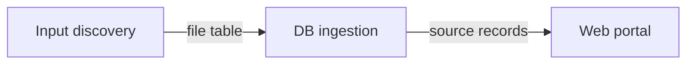
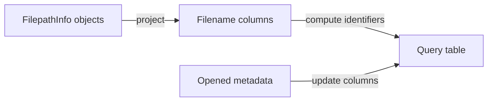
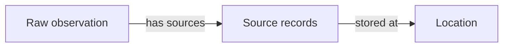

<!-- _class: cover -->
<!-- _paginate: false -->

# LMT telescope files

<p class="subtitle">Discovery, model tables and DB/Web access</p>

<p class="meta"><a href="#5">Input discovery</a> &nbsp; / &nbsp; <a href="#8">Telescope access</a> &nbsp; / &nbsp; <a href="#10">Database</a> &nbsp; / &nbsp; <a href="#13">Web viewer</a></p>

---
# Package responsibilities

| Package or module | Responsibility |
|---|---|
| `tollan` | Configuration, FileLoc, schema/mapping/view infrastructure |
| `tolteca_datamodels` shared modules | Model-table projection, source access, ObsSpec grammar, discovery registration |
| `lmt_base` | Common observation identifiers, metadata and field types |
| `lmt` / `toltec` | Telescope / instrument parsers, readers, file tables and stores |
| `tolteca_db` | Persist source records and observation summaries; return query tables |
| `tolteca_web` | List DB records, resolve selected files, display metadata and plots |

<p class="note">LMT records telescope state. TolTEC records instrument signals and state. TolTEC reduction can select both through <code>toltec_file</code>.</p>

---
# Observation file workflow

<div class="diagram">



</div>

| Operation | Result |
|---|---|
| Discover and populate | Candidate locations plus filename guesses or header information |
| Select table rows | Observation subset for Python use or pipeline dispatch |
| Register selected inputs | Observation records, source URIs and storage locations |
| Follow a telescope link | Open the exact file, read metadata, load plotting samples |

<p class="note">The no-op CLI consumes the input table without reducing signals or publishing reduced products.</p>

---
# Resource and acquisition identity

| Value | Meaning |
|---|---|
| `source` | Resource to open, such as `/cache/a.nc`; open objects accepted |
| `source_loc` | FileLoc for filename identification: `archive:/data_lmt/tel/tel_…nc` |
| `filepath_orig` | Acquisition path recorded in the header |
| `filepath_info_orig` | Parsed acquisition path: prefix, sequence numbers, writer time |

```python
table = LmtFileAccessor.from_sources([
    {"source": cached_path, "source_loc": acquisition_path}
], mode="read")
```

<p class="note">An omitted <code>source_loc</code> uses <code>source</code>. Location columns expose locality, host and scheme. Header reads replace observation guesses while preserving <code>file_*</code> evidence.</p>

<!-- FileLoc location describes a name, not availability. For a local cache of a remote file, only source names the openable resource. filepath_orig does not participate in input-path fallback. -->

---
# Input discovery configuration

<div class="cols">
<div>

```yaml
input_discovery:
  inputs:
    - data_lmt_path: /data/data_lmt
      data_model_select: [toltec]
      obs_spec: 'tcs-145609/tel'
      mode: read
```

### Alternative entry keys

`data_toltec_path`: instrument subtree

`sources`: exact FileLoc values or explicit
`{glob: "/path/tel/*.nc"}` entries

</div>
<div>

| Mode | Population |
|---|---|
| `guess` | Filename information only |
| `guess_or_read` | Read supported sources with unidentified filenames |
| `read` | Read every supported, openable source |

Store entries default to `guess`.<br>Source entries default to `guess_or_read`.

<p class="note">Each entry applies its ObsSpec after population. The pipeline's own input selection acts later on opened metadata.</p>

</div>
</div>

<!-- Configuration chooses a registered entry by its identifying key. No explicit type field is required. Paths resolve using the configuration rootpath. Glob wildcards are only expanded in the explicit glob form. -->

---
# File stores and observation selection

<div class="cols">
<div>

<pre class="tree">data_lmt/
├── tel/                 LMT files
└── toltec/              instrument store
    ├── tcs/toltec0/
    └── …</pre>

- Stores narrow globs without reading headers.
- Full selection follows table population.
- `data_model_select` selects the file models used to classify discovered sources.

</div>
<div>

| Selector | Meaning |
|---|---|
| `tcs-145609/tel` | Telescope files for observation 145609 |
| `tcs-145609/{tel,1}` | Telescope and TolTEC 1 in a TolTEC context |
| `tcs-(145605,145612)/tel` | Telescope files in the half-open observation range |
| `tcs-[-1]/tel` | Largest distinct TCS observation number after value filtering |

<p class="note">Parsing is context-free. Stores and accessors supply label interpretations. Positional selection does not compare file timestamps.</p>

</div>
</div>

---
# Flat model tables

<div class="diagram small">



</div>

| Column group | Examples |
|---|---|
| Resources | `source`, `source_loc`, `source_loc_is_local` |
| Filename evidence | `file_prefix`, `file_ut`, `file_obsnum` |
| Current observation information | `master`, `obsnum`, `interface`, `uid_raw_obs` |
| Header projections | `obs_goal`, `target_ra_deg`, `target_frame`, `t_elapsed_s` |

<p class="note"><code>ModelColumnMapper</code> declares name and type rules. Updates populate the flat table in passes. Consumers use <code>itertuples()</code> or open datasets; no record-model round trip is required.</p>

<!-- Computed filename identifiers run before header population. Header metadata owns its own identifiers and replaces the guessed values. ToltecFileAccessor also computes data_kind and supports bit-flag query predicates. -->

---
# Telescope reader and metadata

```python
with open_lmt_tel(path) as ds:
    meta = ds.lmt_tel.meta
    az = ds.lmt_tel.az.isel(time=slice(0, 100)).load()
```

| API | Contract |
|---|---|
| `LmtTelIOSchema` / `LmtTelIOMapper` | Map header variables and native pointing streams |
| `.meta` | Frozen metadata; readable master, program and goal labels |
| `.meta.target`, `.meta.target_ref` | Main and reference ICRS sky coordinates |
| `.meta.t_int` / `.meta.t_elapsed` | Header integration / timestamp span |
| `.tel_time`, `.t` | Native timestamps and elapsed seconds from the first sample |
| `.az`, `.alt`, `.az_des`, `.alt_des` | Lazy actual and desired pointing arrays |

<!-- Metadata reads headers and timestamp endpoints. file_ut records writer creation time and is independent of the timestamp span. Identification requires the telescope timestamp variable; strict metadata validation occurs when metadata is read. -->

---
# Python selection and resource lifetime

```python
table = LmtFileAccessor.from_sources(paths, mode="read")
pointing = table.lmt_file.query(
    'obs_goal == "pointing" and obs_pgm == "lissajous"'
)
with pointing.lmt_file.open(
    update_from_metadata=True, on_error="raise"
) as opened:
    selected = opened.lmt_file.query(
        '70 <= target_ra_deg < 80 and 60 <= target_dec_deg < 70'
    )
    for row in selected.itertuples(index=False):
        az = row.io_obj.lmt_tel.az.isel(time=slice(0, 100)).load()
```

- `from_sources(..., mode="read")` closes owned files before returning.
- `open()` yields a new metadata-enriched table with temporary `io_obj` entries.
- The context closes owned files; supplied open objects remain borrowed.
- Default `on_error="record"` keeps failed rows and stage diagnostics.

<!-- open defaults to record while from_sources defaults to raise. Selecting a child DataFrame does not extend resource lifetime. Load required array slices inside the context. -->

---
# Database representation

<div class="diagram small">



</div>

| Record | Persisted information |
|---|---|
| `DataProd` with `dp_raw_obs` | Observation identity, start time, available goal/program and integration time |
| `DataProdSource` | Actual resource URI, per-source metadata and data kind |
| `Location` | Storage label and root URI for relative sources |

- Telescope-only observations do not require companion ROACH files.
- Repeat ingestion skips existing source URIs; it does not refresh them.
- Missing header information stays absent. Filename dates are not observation start times.

<!-- DB data-kind codes and public ToltecDataKind flags occupy different integer spaces; the adapter translates them. The source resource is persisted, not a separate identification hint. Raw registration stores references, not arrays. -->

---
# CLI discovery and registration

<div class="cols"><div>

### Add to `tel-inputs.yaml`

```yaml
db:
  binds:
    - {name: local, url: 'sqlite:///products.sqlite'}
  setup:
    db_bind: local
    locations:
      - {label: LMT, root_uri: /data/data_lmt}
data_prod:
  ingest: {db_bind: local, location: LMT}
web: {db_bind: local}
```

</div><div>

### Discover → register → serve

```sh
tolteca_kids --config_paths tel-inputs.yaml \
  --dry_run
tolteca_db db init \
  --config_paths tel-inputs.yaml
tolteca_db ingest inputs \
  --config_paths tel-inputs.yaml
tolteca_web run --config_paths tel-inputs.yaml \
  --web.server.port 8057
```

</div></div>

<p class="note">DB ingestion consumes <code>input_discovery</code>. Each pipeline owns its input selection through its own config.</p>

---
# Query registered files and reopen

```python
with ObsQuery(db_url, location_label="LMT") as query:
    table = query.get_raw_obs_info_table("tcs-145609/tel")

pointing = table.lmt_file.query('obs_goal == "pointing"')
with pointing.lmt_file.open(
    update_from_metadata=True, on_error="raise"
) as opened:
    spans = opened[["uid_raw_obs", "t_int_s", "t_elapsed_s"]]
```

| Operation | Work performed |
|---|---|
| `ObsQuery` | SQL value predicates; distinct-value selection for positions |
| DB record projection | Shared resource and identifier columns, without filename parsing |
| `.lmt_file.query(...)` | Pandas filtering on available columns |
| `.lmt_file.open(...)` | Open files; update metadata when explicitly requested |

<p class="note">The DB summary does not contain every telescope field. Reopening supplies target coordinates and elapsed duration. A supplied SQLAlchemy session remains caller-owned.</p>

---
# Telescope Web viewer

<p class="path">/tel?quartet=tcs-145609-0-2</p>

<div class="cols">
<div>

### Observation metadata

| Item | Value |
|---|---|
| Source | 0449+635 |
| Target ICRS | 72.34713°, 63.53595° |
| Program / goal | lissajous / pointing |
| Header integration | 60.3 s |
| Timestamp span | 68.5 s |

</div>
<div>

### Plot controls

- Source-map or telescope coordinates
- Consecutive-sample averaging
- Trajectory, tracking error, velocity and acceleration
- Azimuth and altitude versus elapsed time

<p class="note">The portal resolves the registered source and opens it with <code>open_lmt_tel</code>. Ambiguous matches, unavailable files and a different header UID produce an error.</p>

</div>
</div>

<!-- Supplemental status fields use a Web-local schema/mapper. The page reads source name from Header.Source.SourceName; this field is not part of the current LmtTelMetadata projection into the DB. Existing plotting formulas remain unchanged. -->

---
# Current scope and remaining boundaries

| Status | Capability or boundary |
|---|---|
| Available locally | File-store and explicit-source discovery, strict telescope metadata, model-table selection, DB registration/query, telescope Web plots |
| Current constraint | Configured discovery and raw ingestion use TolTEC-classified tables, including telescope rows |
| Current constraint | Remote locations can identify records; telescope reads require locally staged resources |
| Incomplete | Full telescope metadata persistence and product-aware portal links |
| Deferred | General instrument discovery context and migration of the legacy Web raw-DB collector |
| Outside this slice | KIDs reduction, reduced-product publication and telescope/instrument alignment |

<p class="note">The existing telescope file remains the authoritative source for metadata and pointing samples.</p>
