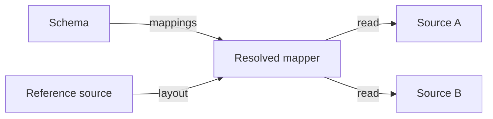
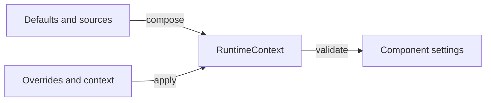
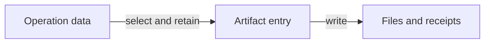
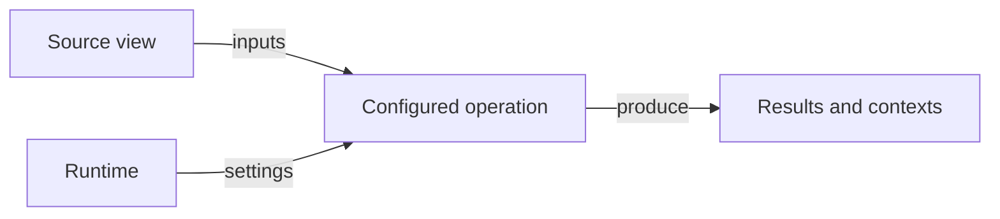

<!-- _class: cover -->
<!-- _paginate: false -->

# Tollan

<p class="subtitle">Architecture and workflows</p>

Reusable infrastructure for scientific Python applications

<!--
Contract: spec.md, Overview. Applications supply domain semantics and operational policy.
-->

---

# Domains and entry paths

| Domain | Purpose | Sections |
|---|---|---|
| Data access and representation | Semantic access, units, flat query tables | [Mappings](#3), [views](#4), [model tables](#5) |
| Application configuration | Compose settings and capture validated configuration | [Runtime](#6), [CLI](#7) |
| Analyses and results | Compute, install and inspect configured results | [API levels](#8), [results](#9) |
| Steps and pipelines | Run operations and record invocation outcomes | [Steps](#10), [drivers](#11) |
| Artifacts and visualization | Select data for exchange and construct presentations | [Artifacts](#12), [visualization](#13) |
| Database resources | Manage SQL resources and shared schema conventions | [Resources](#14), [conventions](#15) |

Data access and configuration work independently. [Integrated workflows](#16) combine them through explicit handoffs.

<!--
Domain names follow spec.md. Supporting utilities appear with schema conventions on slide 15.
-->

---

# Reusable mappings for file batches

A writer commonly produces many files with one layout and different values.

<div class="diagram small">



</div>

```python
mapper = ObservationMapper.from_data_source(reference_source)
signal = mapper.get_var(source, mapper.schema.signal)
```

- Bindings record locations and entity kinds. Reads use the supplied source's values.
- Reuse supports compatible subsets and extensions. Only requested bindings must exist.

<!--
ObservationMapper is the worked example in docs/schema-mapping-accessors.md.
The code reads a second source with the reference layout. Resolution does not fetch array values by default.
Resolve again when an operation needs different locations.
-->

---

# Views, units and source lifetimes

An accessor combines a source and mapper into a domain API.

| Boundary | Contract |
|---|---|
| Source scope | A view reads its source and descendants. It does not search parents or siblings. |
| View lifetime | Treat the bound source as read-only. Cached subviews have no automatic refresh. |
| Units | Present numeric arrays with unit metadata as Astropy quantities. Reuse data where its representation permits. |
| Table conversion | Present selected data as a quantity-aware table. Independent in-place edits require owned data. |
| Deferred data | Fetch or compute only what the requested operation needs. Keep borrowed resources available while needed. |

<!--
Contract: spec.md, Data access and representation. Values may differ between compatible batch sources.
The view lifetime contract does not impose immutability on every source for all time.
-->

---

# Model tables

Project selected object attributes into a flat workspace for queries and enrichment.

```python
columns = {
    "channel": ModelColumn("channel", dtype="Int64"),
    "amplitude": ModelColumn("reading.amplitude", dtype="Float64",
                             default=None),
}
table = ModelTableAccessor.from_models(samples, columns=columns)
selected = ModelTableAccessor(table).query("amplitude > 1")
```

| Operation | Boundary |
|---|---|
| Projection | Read declared attributes in row order, without serializing input objects. |
| Enrichment | Update addressed rows and columns. A projected null replaces an earlier value. |
| Storage | Preserve declared types. Reject lossy numeric storage and incompatible writes. |

<!--
Imports and sample objects follow docs/model-tables.md. This example selects channel 1.
Model tables do not synchronize edits back to source objects. In-place enrichment is not transactional.
-->

---

# Runtime configuration

Compose settings from multiple sources, then capture validated component settings.

<div class="diagram small">



</div>

```python
rc = RuntimeContext()
rc.update_default_config({"search": {"pattern": "error"}})
handler = SearchHandler(rc)
```

- Frozen models validate settings, defaults and scientific value types.
- Later runtime changes affect newly constructed components.

<!--
SearchHandler is the component example in docs/configuration.md. ConfigHandler owns its validated snapshot.
Scientific field types include units, time and paths. YAML persistence preserves validated value meaning.
Time serialization preserves precision.
-->

---

# Command-line applications

`create_cli` supplies version, help and logging setup through `TollanTyper`.

```python
app = create_cli(version="1.0")

@app.command()
def show_files(file_names: Annotated[list[str], MultiOption()]):
    for name in file_names:
        typer.echo(name)
```

```console
python app.py show_files --file_names first.txt second.txt
```

Names retain underscores. Multi-value options also accumulate repeated flags.

`RuntimeContext.add_cli_options()` and `from_cli_ctx()` connect the CLI to the same configuration system used from Python.

<!--
Imports: typing.Annotated, typer, and tollan.utils.typer.{MultiOption,create_cli}.
Runtime configuration options can be attached to a command or callback. The application passes the runtime to consumers.
-->

---

# Analysis and step API levels

| Level | Responsibility | Worked example calls |
|---|---|---|
| **High** | Complete configured operation, with result or invocation lifecycle | `analysis(values)`<br>`Scale(factor=3.0)(tree)` |
| **Middle** | Adapt domain inputs, apply settings, compose computations and assemble results | `analysis.make_mean(values)`<br>`Scale.run(tree, context)` |
| **Low** | Numerical inputs and explicit parameters | `MeanAnalysis.compute_mean(values, axis=0)`<br>`Scale.compute_scaled(values, factor=3.0)` |

The middle level may use an instance or a classmethod. Its data interchange protocol determines how it receives settings and context.

Low-level routines preserve inputs and remain independent of configuration models, views and invocation state.

<!--
MeanAnalysis and Scale are worked examples in docs/analyses.md and docs/examples/pipeline_example.py.
The levels describe responsibilities. Components can reuse existing computations without adding duplicate APIs.
-->

---

# Analysis results and producing settings

<div class="cols">
<div>

```python
analysis = MeanAnalysis()
scope = analysis([1., 2., 3.])
view = MeanView(scope)
assert view.mean["mean"].item() == 2.0
assert view.mean_analysis == analysis
```

The analysis owns its validated configuration, computation and output scope.

A result view recovers producing settings from the result namespace.

</div>
<div>

### Example result layout

<pre class="tree">/  shared scope
└── example.mean
    attrs: producing settings
    └── mean
        Dataset: mean = 2.0</pre>

- Shared scopes have no local or inherited dimensions or coordinates. Scalars may remain.
- Other analyses can own separate namespaces in the same scope.

</div>
</div>

Compose the complete namespace before replacing it. Preserve other namespaces. Each analysis defines when an existing result can be reused.

<!--
Reading a restored namespace is an input contract. Tollan does not promise a storage-backend round trip.
Configuration equality alone does not prove input equivalence. Failed composition preserves installed results.
-->

---

# Step invocations and published payloads

<div class="cols">
<div>

```python
tree = xr.DataTree.from_dict({
    "raw": xr.Dataset({
        "signal": ("sample", [1., 2.])
    })
})
returned = Scale(factor=3.0)(tree)
context = Scale.get_context(tree)
assert returned is tree
assert context.completed
```

The example installs `scaled` and publishes its view through `context.data`.

</div>
<div>

| Object | Responsibility |
|---|---|
| Step configuration | Validated settings |
| Working data | Shared caller object, possibly modified |
| Invocation context | Settings, outcome, failures and payload |
| Artifact context | Selected data retained by this invocation |

Reinvocation exposes the latest context for that operation and alias.

</div>
</div>

Contexts support pickle transport for inspection and diagnostics when their classes and payload resources remain available.

<!--
Scale is the current runnable guide example. Pickle support is not checkpoint/resume or a scientific product format.
Direct Scale.run(tree, context) leaves lifecycle attachment and completion to the caller.
-->

---

# Execution drivers and failure boundaries

A dependency graph describes what steps need. `SequentialPipeline` executes an application-supplied order over shared working data.

| Step outcome | Invocation record | Sequential driver |
|---|---|---|
| Normal return, no failures | Complete | Continues |
| Normal return, recorded failures | Incomplete with failures | Continues |
| Operation exception | Failure recorded, exception propagated | Stops |
| User interruption or termination | Propagates without an operation-failure classification | Stops |

Consumers check their input requirements. The application decides whether the workflow achieved its outcome.

Sequential execution adds no implicit retry or rollback. Step contracts permit other drivers, including DAG scheduling.

<!--
Source: src/tollan/pipeline/step.py. A completed context does not certify future evaluation of deferred arrays.
Other drivers are permitted by the contract, not shipped scheduler integrations asserted by this deck.
-->

---

# Artifacts select data for persistence or exchange

An artifact bundles a useful portion or all of an operation's data context with its effective specification.

<div class="diagram small">



</div>

```python
spec = RecordSpec(fields=("accepted", "rejected"))
selected = spec({"accepted": 12, "rejected": 2, "examined": 20})
artifacts = ArtifactContext()
entry = artifacts.add(spec, selected)
files = entry.spec.write(entry.data, path=destination)
```

Retention shares references. It does not copy, compute or export the data. Producing data does not automatically retain it.

<!--
RecordSpec is the JSON selection example in docs/artifacts.md. destination is a caller-supplied Path.
ArtifactContext keys by spec type and alias. Reusing a key replaces that entry.
-->

---

# Visualization consumes data

A visualization constructs a native presentation object. The figure can be used directly or retained as an artifact.

```python
viz = SignalViz(line_width=3.0, save_formats=["html"])
figure = viz(values)
artifacts = ArtifactContext()
entry = artifacts.add(viz, figure)
files = entry.spec.write(entry.data, path=destination)
```

| Operation | Effect |
|---|---|
| Construct | Consume the visualization's declared inputs and build a figure |
| Retain | Keep the figure with the settings used to construct and export it |
| Display or export | Consume the existing figure without repeating construction |

Each step invocation receives a fresh artifact context, separately from its typed payload.

<!--
SignalViz is defined in docs/examples/artifact_example.py. HTML export works without a static-image renderer.
Export failures propagate and may leave earlier writes. Publication policy belongs to the product publisher.
-->

---

# Database resources and transactions

`SqlaDB` manages SQLAlchemy resources for repeated operations.

```python
with SqlaDB.from_url("sqlite://") as db:
    with db.session_context() as session:
        session.execute(text("create table reading (value integer)"))
        session.execute(text("insert into reading values (42)"))
    with db.connect() as connection:
        value = connection.scalar(text("select value from reading"))
```

| Boundary | Behavior |
|---|---|
| Resource | Owns an engine created from a URL. Borrows a supplied engine. |
| Session context | Creates a fresh session. Commits pending work on success, rolls back on error, then closes. |
| Shared transaction | Pass the same session to participating operations. Nested contexts create separate sessions. |

Connections and sessions finish before the resource closes.

<!--
SqlaDB is a plain Python resource wrapper, not a Pydantic settings model.
Construction does not connect or create schema. Reflection is explicit.
Connection contexts close without committing. An explicit commit cannot be undone by a later failure.
-->

---

# Shared declarations and supporting utilities

Database declarations provide conventions that application schemas can reuse.

| Area | Tollan responsibility |
|---|---|
| Column types and timestamps | Shared identities, descriptive fields and UTC timestamp conventions |
| Actor attribution | Portable actor identities and references in application-owned models |
| Batch writes | Prepared SQLite upserts inside the supplied transaction |

Utilities serve repeated needs across domains.

| Infrastructure | Contract |
|---|---|
| Keyed registries | Reject duplicate keys and expose registered capabilities without mapping mutation |
| Runtime generic bindings | Resolve declared generic types for framework use without parallel type declarations |

Applications retain their own schema, queries and attribution policy.

<!--
Small utilities are not exhaustively enumerated. See spec.md, Database resources and Supporting utilities.
Registry entries remain supplied objects; the registry does not validate them.
-->

---

# Integrated workflow handoffs

<div class="diagram">



</div>

| Handoff | Information retained |
|---|---|
| Analysis to result view | Outputs and producing configuration |
| Step to downstream consumer | Working data plus invocation outcome and typed payload |
| Operation to artifact consumer | Selected data and effective specification |

Applications choose the combinations they need. Each domain remains independently usable.

<!--
This diagram shows possible transfers, not a mandatory pipeline or an automatic publication service.
Database resources can serve application operations independently of this data path.
-->
