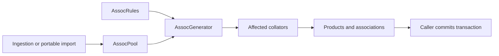
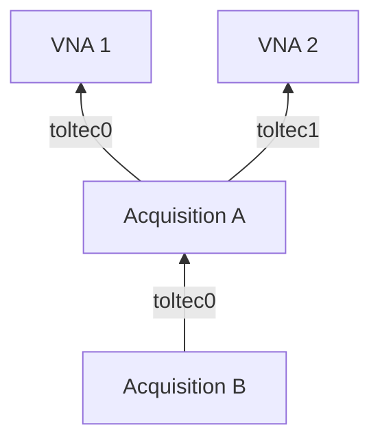
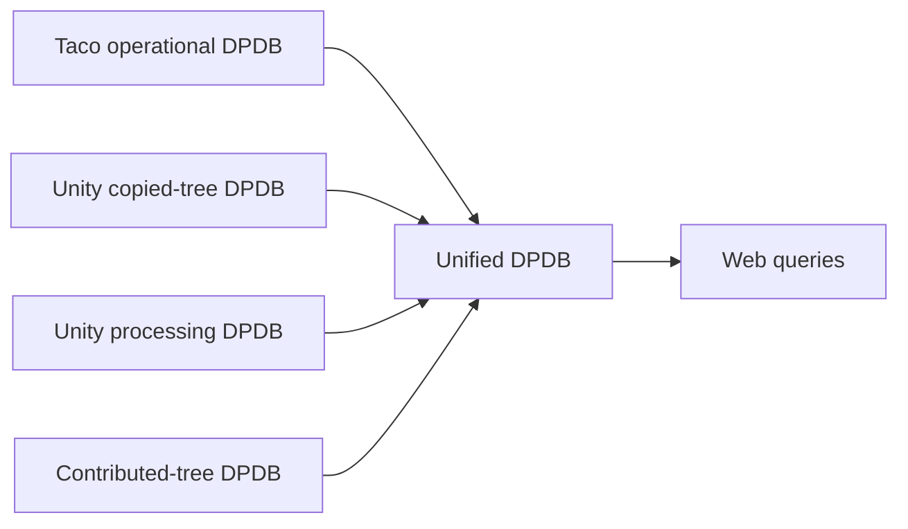
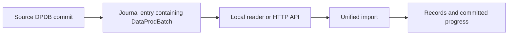
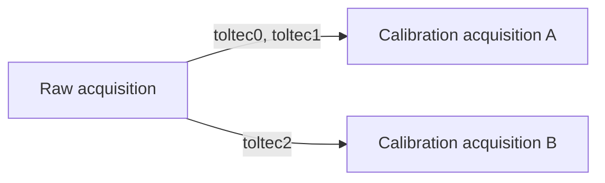
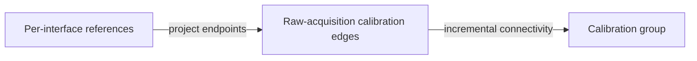

<!-- _class: cover -->
<!-- _paginate: false -->

# Associations and inventories

<p class="subtitle">Incremental relationships, independent databases and unified queries</p>

---
# Contents

<div class="cols">
<div>

[Relationship and inventory boundaries](#3)

[Metadata association rules](#4)

[Association generation](#5)

[Incremental maintenance](#6)

[Calibration evidence and groups](#7)

[Independent inventories](#8)

</div>
<div>

[Namespace identity and inventory paths](#9)

[Bootstrap and incremental import](#10)

[Merge semantics](#11)

[Selection labels across inventories](#12)

[Query and presentation](#13)

[Recovery and current limits](#14)

</div>
</div>

<p class="note"><a href="#15">API and structure reference</a></p>

---
# Relationship and inventory boundaries

| Concept | Meaning |
|---|---|
| DPA | Directed edge from a produced / specialized product to an existing product |
| Intrinsic metadata rules | Relationships deduced from acquisition facts |
| Version membership | A realized product in its global version group |
| Inventory | Logical reporting identity for products, items, runs and selections |
| Unified inventory | Derived DPDB combining participating inventories |

---
# Metadata association rules

| `AssocRules` switch | Relation direction | Exact match / evidence |
|---|---|---|
| `obs_raw_obs` | Observation → raw acquisition | Same master + obsnum; creates `dp_obs` if needed |
| `raw_obs_proc_raw_obs` | Processed realization → raw acquisition | Same quartet; marks the raw product as primary |
| `raw_obs_cal_obs` | Raw acquisition → calibration raw acquisition | Per-interface `cal_*` quartet; edge context lists interfaces |
| `cal_group` | Calibration group → acquisitions | Connected lineage; original VNA primary edge stored, membership projected |

- All four switches default to `true` when `AssocRules` is configured.
- Every processed realization participates, across namespaces and runs.
- Namespace and version identify endpoints; the association has no extra scope.
- Drive-fit, focus and OOF grouping rules remain separate work.

---
# Association generation

<div class="diagram">



</div>

| Class | Role |
|---|---|
| `AssocPool` | Incoming facts in one writable session |
| `AssocRules` | Typed configuration of enabled metadata relationships |
| `AssocGenerator` | Apply collators; explicit reconciliation for repair |

---
# Incremental maintenance

- Add changed products and sources to the invocation's pool.
- Resolve affected identities and dependencies through indexed lookups.
- Maintain per-interface calibration evidence and persistent connectivity.
- Update derived acquisition relationships and group summaries.
- Commit ingestion and association changes together.

```python
from tolteca_db.associations import AssocGenerator, AssocRules

# Explicit repair of selected registered products
report = AssocGenerator(AssocRules()).reconcile(
    session, products=affected_products,
)
```

<p class="note">A full reconciliation is an explicit operation. Live ingestion and portable import consume changed facts.</p>

---
# Calibration evidence and groups

<div class="cols"><div>



</div><div>

- `raw_obs_file_cal_obs_file` retains per-interface evidence.
- Raw-observation calibration edges collect contributing interfaces.
- Groups follow connectivity across all these relations.
- Several VNA roots can enter one acquisition-level component.
- Merges keep the earlier group UID and redirects.

</div></div>

<p class="note">Missing calibration master stays unresolved until evidence identifies it. Acquisition headers currently omit that field.</p>

---
# Independent inventories

<div class="diagram">



</div>

Taco continues acquisition and quicklook. Copies retain their own transfer history. Native Unity reductions have their own outputs. The unified destination can be rebuilt from those sources.

---
# Namespace identity and inventory paths

| Inventory | Namespace UUID | Path | Display |
|---|---|---|---|
| Live Taco | N | `ql` | `taco:ql` |
| Copied tree on Unity | N | `taco/ql` | `unity:taco/ql` |
| Unity reductions | M | `ql` | `unity:ql` |

- Copying preserves product, namespace and run identities.
- Each inventory reports its own included records and source locations.
- `DataProdInventoryNamespace` records the path in each inventory.
- The path does not imply local or remote file access.
- Source location roots determine how artifacts are retrieved.

---
# Bootstrap and incremental import

<div class="diagram">



</div>

| Phase | Boundary |
|---|---|
| First contact | Consistent current snapshot and journal horizon |
| Later calls | Bounded committed pages after saved sequence |
| Destination commit | Imported records and progress together |
| Retry | Resume the destination’s committed position |

---
# Merge semantics

| Incoming information | Result |
|---|---|
| Same raw observation / observation | Shared logical product, enriched known sources and summaries |
| Complementary telescope / KIDs files | One acquisition with both interfaces |
| Same realized product / run | Preserve identity; add reporting inventory and source locations |
| Intrinsic relationships | Use the same pool/rules machinery as ingestion |
| Version group | Global group with versions across namespaces |
| Conflicting evidence | Warn / retain diagnostics according to registration rules |

<p class="note">Telescope header / LMTMC normalization is incomplete and currently merges permissively. Some summary fields can still depend on arrival order.</p>

---
# Selection labels across inventories

```yaml
data_prod:
  unify:
    destination_bind: unified
    sources:
      - source_bind: taco
        placement: {inventory_name: taco, tag_labels: {main: 'taco:main'}}
      - source_bind: unity
        placement: {inventory_name: unity, tag_labels: {main: 'unity:main'}}
    tag_selections: {main: 'unity:main'}
    tag_inventory:
      uid: 56d63c6e-51cc-4409-a370-2095e60993c7
      name: unified
```

<p class="note">Configuration excerpt: binds are declared under db. Each tag points directly to one membership. Local labels use forms such as ql-main; colon qualifies imported selections.</p>

---
# Query and presentation

| Consumer | Behavior |
|---|---|
| Web product queries | Read the unified DPDB |
| Association graph | Product-kind colors; relation / inventory-path filters; native Cytoscape layouts |
| Graph filtering | Client-side filtering and re-layout of the loaded graph |
| Scientific viewer | Resolve selected source, open interface / block / channels |
| Direct multi-DB view | Alternative architecture; independent source queries remain possible |

<p class="note">Metadata import does not copy scientific arrays. Transfer and partial remote data access have their own policies.</p>

---
# Recovery and current limits

| Condition | Current behavior |
|---|---|
| Source unavailable | Keep committed progress; retry later |
| One source unavailable in Dagster sensor | Continue checking other sources |
| Changed source placement / selection policy | Rebuild a fresh destination |
| Source history missing or behind progress | Stop rather than invent missing changes |
| Source removed from configuration | Existing destination contributions remain |
| Pure unified projection | No default owner or publisher required; imported ownership retained |

Journal capture covers supported ORM registration transactions. Raw SQL, bulk writes, deletions and QA annotations are outside current capture. Journal pruning is not implemented.

---
<!-- _class: section-title -->
# API and structure reference

Detailed interfaces and data layouts

---
# Per-interface calibration references

<div class="diagram small">



</div>

| Available information | Registration |
|---|---|
| Complete calibration quartet | Logical target + edge, even without local files |
| Missing calibration master | Partial reference + unresolved issue; no guessed target |
| Target records or files arrive later | Enrich the same product; preserve its edges |

<p class="note">Current headers omit calibration master. ToltecDB resolves it from the target triple and ROACH. File refresh preserves that result only while the reference triple agrees.</p>

---
# Calibration groups: evidence and projection

<div class="diagram small">



</div>

| Layer | Contents |
|---|---|
| `raw_obs_file_cal_obs_file` | Recorded interface target; incomplete references retained; VNA self-reference |
| `dpa_raw_obs_cal_obs` | Acquisition → calibration acquisition; contributing interfaces |
| `raw_obs_cal_component` | Persistent connectivity, separate from directed calibration ancestry |
| `dp_cal_group` | Intrinsic group, independent of namespace, processing run and file location |

<p class="note">One acquisition can join interfaces tracing to different VNAs. Group membership follows the connected component; projection adds no per-file calibration facts.</p>

---
# Calibration groups: identity and access

| Operation | Behavior |
|---|---|
| VNA arrives | Open `dp_cal_group_<VNA quartet>` |
| New reference | Union affected components; preserve unresolved references |
| Groups merge | Earlier VNA UID remains current; old group UIDs resolve to it |
| Read or transfer | Query current membership; preserve original VNA anchors and interface evidence |

```python
from tolteca_db.api import get_calibration_group
from tolteca_datamodels.data_prod import DataProdRef

result = get_calibration_group(session, DataProdRef(uid="ics-18356-0-0"))
# group: dp_cal_group_ics-18343-0-0; 13 acquisitions, 5 VNAs
```

- Union-by-size roots are separate from public identity; merges avoid bulk member rewrites.
- Web **Calibration lineage** shows members, VNA roots and missing references.

---
# Association configuration: composition

<div class="cols"><div>

### One root handler

```yaml
data_prod:
  associate:
    db_bind: products
    rules:
      obs_raw_obs: true
      raw_obs_proc_raw_obs: true
      raw_obs_cal_obs: true
```

</div><div>

### The same rule configuration

| Field | Model |
|---|---|
| `data_prod` | `DataProdConfig` |
| `.associate` | `DataProdAssocConfig` |
| `.associate.rules` | `AssocRules` |
| `.ingest.associations` | Optional `AssocRules` |
| `.acquisition.associations` | Optional `AssocRules` |

</div></div>

<p class="note">Ingestion runs rules only when its associations field is configured. Omission leaves it disabled. Standalone association generation works on already registered metadata.</p>

---
# Batches, journal delivery and import progress

| Model | Responsibility |
|---|---|
| `DataProdBatch` | Portable product, namespace and inventory indexes for registration |
| `DataProdJournal` | Publishing inventory and latest committed sequence |
| `DataProdJournalEntry` | Batch saved atomically with a captured DB transaction |
| `DataProdImportState` | Applied source sequence and import policy at the destination |

- An entry can include many products and producing runs.
- Its sequence orders delivery independently of database primary keys.
- Default write owner and journal publisher are independent, optional roles.
- CLI and scheduled writes use the same transaction capture.
- Destination records and import progress commit together.

<p class="note">An inventory is logical; it has no filesystem root. Location resolves artifact storage. A journal belongs to the publishing inventory, independently of the host running its database.</p>
