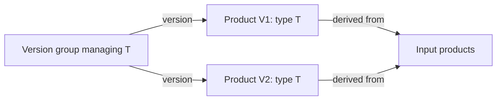
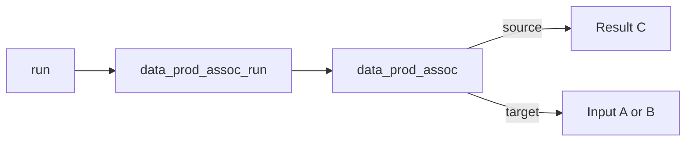
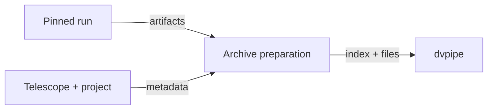

<!-- _class: cover -->
<!-- _paginate: false -->

# Data products and publication

<p class="subtitle">Identities, versions, storage, provenance and output actions</p>

---

# Contents

<div class="cols">
<div>

[Product identity rules](#3)

[Logical products and realized versions](#4)

[Identity, name and storage](#5)

[Filesystem projection](#6)

[Run allocation and tags](#7)

[Publication actions](#8)

</div>
<div>

[Stored interface layout](#9)

[Scientific data and external views](#10)

[Metadata ownership](#11)

[Resolved workflow configuration](#12)

[Relational representation](#13)

[Portable registration and reopening](#14)

</div>
</div>

<p class="note"><a href="#15">API and structure reference</a></p>

---

# Product identity rules

| Product | Namespace ownership | UID |
|---|---|---|
| Singleton observation | Shared across namespaces | `{uid_obs}` |
| Singleton raw acquisition | Shared across namespaces | `{uid_raw_obs}` |
| Version group | Global | `{logical_product_identifier}` |
| Intrinsic calibration group | None | `dp_cal_group_<opening VNA quartet>` |
| Realized non-singleton product | Producing namespace | `{version_group.uid}/{run_uid}` |

- Every non-singleton product belongs to a version group.
- Group type: `dp_version_group`; `meta.content_data_prod_type` is the type shared by its versions.
- Each version owns its metadata, associations and sources.
- `dp.name` reads `meta.name`; product display names need not be unique.

<p class="note">Run UUIDs make realized-product UIDs globally distinct. Each result belongs to its producing namespace. Versions from different namespaces share one logical group.</p>

---

# Logical products and realized versions

<div class="diagram">



</div>

| Product | Identity |
|---|---|
| `dp_obs`, `dp_raw_obs` | Singleton per entity, across namespaces and locations |
| `dp_version_group` | Stable identity; manages versions of one declared DP type |
| Realized product | Independently identified result of a run |

<p class="note">Generic named groups may mix types. Version groups require all version members to match their declared product type. DPA direction follows the operation: result or group → inputs.</p>

---

# Identity, name and storage

| Value | Role |
|---|---|
| `uid_obs`, `uid_raw_obs`, `uid_raw_obs_file` | Observation, acquisition and acquisition-file identities |
| `run.uid` / `run.name` | Portable invocation UUID / namespace-unique readable directory name |
| Namespace UUID | Producing output history |
| Inventory + namespace path | Reported path, displayed as `taco:ql` or `unity:taco/ql` |
| `dp.uid`, `meta.name` | Product identity / display name |
| Location + source URI | Artifact access, independent of product namespace |

---

# Filesystem projection

<pre class="tree">dataprod_toltec/
└── ql/
    ├── namespace.yaml
    ├── .runs/by_uid/<run_uid>/run.yaml     invocation record
    └── 145609-0-1/
        ├── dp_raw_obs.yaml
        └── dp_raw_obs_proc/
            ├── index.yaml                 version group + tags
            └── 0007-nightly/              run.name
                ├── index.yaml             exact product + provenance
                ├── array.zarr/
                └── …                      plots / feedback</pre>

<p class="note">TCS is omitted in directory labels. Other masters remain. This is a filesystem projection of product relationships. Portable descriptors and registered inventories can recreate it.</p>

---

# Run allocation and tags

```yaml
kids:
  output:
    enabled: true
    namespace: ql
    run:
      name: {generator: counter, key: nightly}
    tag: ql-main
```

- `run.uid` is supplied or generated once per invocation.
- Counter state belongs to the namespace; consumed reservations are retained.
- A tag selects one version-group membership across namespaces in that DPDB.
- Local publishers choose labels such as `main` or `ql-main`.
- Imported selections can use `taco:main`; qualification is explicit.

---

# Publication actions

<div class="diagram">


</div>

| Setting / outcome | Behavior |
|---|---|
| `kids.output.enabled` | Materialize product files |
| `kids.output.registration` | Invoke configured `data_prod.index` registration |
| Registration failure | Published files remain available for retry |
| Conflicting tag publication | Fail on the held publication lock |

---

# Stored interface layout

<pre class="tree">array.zarr/                       product scope
├── toltec0/                      acquisition-file metadata
│   ├── blocks/index/             block table
│   ├── blocks/chan/              shared channel table
│   ├── blocks/probe/             shared probe table
│   ├── blocks/0/sweep/           reduced Dataset
│   ├── blocks/0/sweep_check/     optional diagnostic datasets
│   └── tolteca_kids/             acquisition step records
└── toltec1/                      another selected interface</pre>

<p class="note">Layout stays the same for one interface. Current writer covers selected KIDs interfaces. HWPR fits the interface-root contract; its product integration remains pending.</p>

---

# Scientific data and external views

| Content | Storage |
|---|---|
| Block index, channel/probe axes, reduced I/Q | Zarr datasets |
| Installed D21 / PSD / sweep checks | Result subtrees in the same Zarr |
| Sweep-check figures and quicklook feedback | External HTML / PNG / JSON, listed in the index |
| Resolved workflow and input references | Run index provenance |
| Finding tables, ECSV exports, diagnostic pickles | Further producer/exporter work; not part of this slice |

<p class="note">No separate manifest.json. The index describes product sources; Zarr stores scientific structure and result metadata.</p>

---

# Metadata ownership

| Owner | Contents |
|---|---|
| `namespace.yaml` | Namespace identity, counter and actor records |
| `.runs/by_uid/<run_uid>/run.yaml` | Invocation state and publication requests |
| Group `index.yaml` | Version memberships and current tag selections |
| Run `index.yaml` / DB `run.context` | Selected inputs, resolved workflow, publication provenance |
| Interface and block attrs | Acquisition / block metadata |
| `tolteca_kids` at each execution scope | Serialized step settings, completion and failures |
| Analysis namespace attrs | Producing D21 / PSD configuration snapshots |

---

# Resolved workflow configuration

<p class="path">&lt;run.name&gt;/index.yaml → provenance.inputs[interface].config</p>

| Run-index record | Contents |
|---|---|
| `inputs[interface].config` | Full workflow after defaults, conditions and overrides; disabled operations included |
| `inputs[interface]` | Raw-file UID, requested source and resolved reader location |
| `output` | Actual publication settings; `run.uid` identifies the invocation; `run.name` names its directory |
| `runtime_info`, `software` | Publication host/process information and installed package versions |

- A saved default of `1` replays as `1`, even if today's default is `2`.

<p class="note">The relational owner is run.context; stable environment facts belong to actor.meta. Standalone steps may lack a workflow snapshot. Input checksums and an environment lock are not captured.</p>

<!-- Table fields are relative to provenance; run.uid and run.name are at the index root.
Execution depends on resolved values, input data and software environment.
Original recipe text and explicit-versus-default field presence do not control replay. -->

---

# Relational representation

| Tables | Responsibility |
|---|---|
| `data_prod`, `data_prod_type` | Typed products, metadata and lifecycle |
| `data_prod_assoc`, `data_prod_assoc_type` | Directed product relationships |
| `run`, `data_prod_assoc_run`, `actor` | Invocations, edge provenance and attribution |
| `data_prod_tag` | Current version-group selections |
| `data_prod_item`, `location` | Product constituents, source references and access roots |
| `data_prod_inventory`, `data_prod_inventory_namespace` / membership tables | Which inventory reports each namespace path and record |

---

# Portable registration and reopening

| Operation | Input | Result |
|---|---|---|
| Index registration | Portable YAML + namespace descriptor | DPDB records and associations |
| Inventory registration | Portable record batch | Products, runs, sources and reporting ownership |
| Scientific reopening | Registered source + location | Selected interface / block views |
| Filesystem export | Registered inventory projection | Portable product-store tree |

- Local database primary keys never become portable identities.
- Relative locations resolve against the containing index.
- Product queries do not require the original index files after registration.
- Scientific payloads remain separate from metadata registration.

---

<!-- _class: section-title -->
# API and structure reference

Detailed interfaces and data layouts

---

# Primary access

<div class="cols">
<div>

### Typed association in the product

```yaml
assocs:
  - data_prod_assoc_type:
      dpa_raw_obs_proc_raw_obs
    uid: tcs-145609-0-1
    is_primary: true
    context: {}
```

<p class="note">is_primary selects a typed link; default False.</p>

</div>
<div>

### Resolve the terminal primary

```python
# Portable indexes: supply a reference lookup.
primary = index.product.get_primary(
    products.__getitem__
)

# ORM product: keep the session open.
primary = product.primary
primary_uid = primary.uid
```


</div>
</div>

---

# Portable index — current format

| Index field | Contract |
|---|---|
| `format_version` | Portable YAML format version |
| `product` | Identity, typed metadata, data items, associations and tags |
| `locations` | Named storage roots |
| `namespace`, `actors`, `run` | Supporting identity and attribution records |
| `provenance` | Producing workflow and selected inputs |
| `products` | Related portable product documents |

- Read a named YAML file or a folder containing `index.yaml`.
- Relative location roots resolve against the containing index; source URIs resolve against that root.
- YAML contains no database primary keys; reading it does not open numerical payloads.

---

# Product contents and supporting models

| Model | Responsibility |
|---|---|
| `DataProd` | Identity, metadata, constituents, relationships and tags |
| `DataProdItem` | One constituent with its own metadata and source |
| `DataProdSource` | URI, location reference and storage verification facts |
| `Location` | Root used to resolve relative source URIs |
| `Actor` | Stable attribution for the producing environment |
| `WorkflowRun` | One invocation and its resolved execution context |

<p class="note">A raw observation can contain telescope and KIDs files. A processing product can also contain calibration inputs and generated artifacts. Each item retains its own metadata.</p>

---

# Publication and registration APIs

| API | Responsibility |
|---|---|
| `DataProdIndex` | Portable product document with supporting records |
| `DataProdBatch` | Validated submission: metadata and multiple indexes / runs |
| `DataProdStore` | Filesystem layout, run allocation and publication |
| `store.create_run()` | Yield a live `WorkflowRunContext`; reserve and finalize the run |
| `store.publish(..., run=...)` | Stage and commit one product publication |
| `ingest_data_prod_batch(session, batch)` | Register portable contents in a caller-owned transaction |

<p class="note">One run can publish several products. A batch can submit products from several runs. File publication and database registration are separate operations.</p>

---

# Metadata owners in the relational model

| Information | Owner |
|---|---|
| Stable client and deployment environment | `actor.meta` |
| Namespace identity and counter | `data_prod_namespace` |
| Path in one inventory | `data_prod_inventory_namespace` |
| Run state and invocation facts | `run`, `run.meta` |
| Full resolved workflow and selected inputs | `run.context` |
| Edge-specific execution context | `data_prod_assoc_run.context` |
| Product facts, including declared product type | `data_prod.meta` |
| Current selection; artifact access | `data_prod_tag`; `data_prod_item` + `location` |

<p class="note">Step and analysis snapshots stay in Zarr. Full workflow config belongs to the run; edge context records only execution details for that association.</p>

---

# Result configuration snapshots

| Result owner | Snapshot location | Access |
|---|---|---|
| Sweep reducer | `blocks/<block>/sweep` dataset attrs | Stored calculation settings, such as uncertainty calculation |
| D21 analysis | Its namespace attrs under `blocks/<block>` | D21 view's `.d21_analysis` |
| PSD analysis | Its namespace attrs under `blocks/<block>` | PSD view's `.psd_analysis` |

- Each analysis namespace owns its snapshot and result datasets.
- Reused results retain their producing configuration.

<p class="note">A workflow configuration describes the request. Installed results and saved execution records establish what is available.</p>

<!-- Result snapshots describe the calculation that produced the arrays.
Step selection, aliases and force controls belong to step records. -->

---

# Actors and record attribution

| Owner | Fields and responsibility |
|---|---|
| `actor` | Local `pk`, portable `uid`, name, immutable `meta`, creation time |
| Stable actor facts | Hostname, user and deployment/environment facts shared across runs |
| Mutable records | `created_at`, `created_by_fk`, `updated_at`, `updated_by_fk` |
| `run` | Invocation-specific settings, selected inputs, commands and timing |

- Changed recorded environment facts select a different actor.
- Import preserves attribution and remaps actor FKs.
- Idempotent import leaves modification time unchanged.

<p class="note">Actors have no recursive creator/updater FKs. Actor metadata/reuse and historical attribution need migration rules. Generic DB auditing is deployment infrastructure; EventLog is removed from the runtime ORM.</p>

---

# Runs link to product associations

<div class="diagram small">



</div>

| Junction field | Contract |
|---|---|
| `run_fk`, `data_prod_assoc_fk` | Composite primary key |
| `context` | Execution details specific to this edge |
| `created_at`, `created_by_fk` | Attribution of this link |

<p class="note">A + B → R → C links R to C → A and C → B. Full workflow config stays on run.context. Relation type distinguishes derivation from grouping; no run_data_prod table is needed.</p>

---

# Tags select outgoing associations

<div class="cols">
<div>

### Product graph

<pre>A       version group
A/1     realized product
A/2     realized product

E1: A → A/1
E2: A → A/2</pre>

</div>
<div>

### `data_prod_tag`

| Owning DP | Label | Selected DPA |
|---|---|---|
| A | main | E1 |
| A | test | E2 |

- Unique `(data_prod_fk, label)`.
- Selected DPA originates at the owner.
- Several labels may select one edge.
- Null selection represents an empty tag.

</div>
</div>

<p class="note">The group is global; selected versions retain their producing namespaces. Selection targets a completed version of the declared product type. Creator/modifier fields record current attribution; append-only tag-selection history remains a deferred proposal.</p>

---

# Archive handoff

<p class="path">TolTEC adapter and packaging are deferred</p>

<div class="diagram small">



</div>

| Archive material | Role |
|---|---|
| `LmtMetadataBlock` YAML | Project, observation, instrument, bands, processing level and release metadata |
| dvpipe dataset index | Citation/dataset metadata and concrete file inventory |
| Packaged payloads | Selected run’s arrays and export artifacts; Zarr directory packaging still to define |

<p class="note">Product index, LMT metadata YAML and dvpipe dataset index are distinct contracts. Readout tone frequency is not astronomical band frequency.</p>
