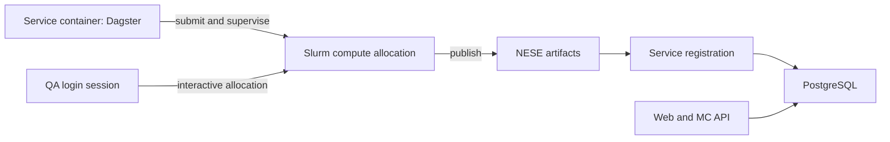
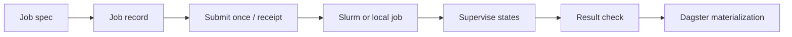

<!-- _class: cover -->
<!-- _paginate: false -->

# Deployment and execution

<p class="subtitle">Software locations, service configuration and external execution</p>

---

# Contents

<div class="cols">
<div>

[Deployment ownership](#3)

[Location and service configuration](#4)

[Configuration boundaries](#5)

[Unity service and compute topology](#6)

[Dagster instances and code locations](#7)

[Execution profiles](#8)

</div>
<div>

[Requests and job specs](#9)

[Admission and scheduler policy](#10)

[Job records and supervision](#11)

[Retries, cancellation and reattachment](#12)

[Execution from Dagster](#13)

[Operational scope](#14)

</div>
</div>

---

# Deployment ownership

| Layer | Owner | Responsibility |
|---|---|---|
| Scientific workflow | Application package | Workloads, commands, settings and result checks |
| Service profile | Service package | Baseline configuration, entry points and recipes |
| Software location | `tolteca_deploy` | Environment, source versions and profile projection |
| Execution profiles | Deployment | Where each workload runs, resource limits, site values |
| External execution | Tollan (`tollan.execution`) | Placement, job records, supervision, Dagster Pipes |
| Allocation | Slurm | Actual nodes, resources and cluster capacity |

---

# Location and service configuration

<pre class="tree">location/
├── location.yaml                sources and environment
├── .venv/                       Python runtime
├── src/                         package checkouts
└── run/
    ├── justfile                 projected service modules
    ├── data_lmt/                input view
    └── tolteca_web/
        ├── config.d/            application settings
        ├── justfile             service recipes
        └── dagster_*.py         code-location entry points</pre>

<p class="note">Packages own baseline profiles. Deployment selects profiles and local overrides. Resolve queued work to a fixed physical environment.</p>

---

# Configuration boundaries

| Configuration | Purpose |
|---|---|
| `location.yaml` | Software composition and deployed service profiles |
| Workflow YAML | Inputs, DB roles, processing, output and query services |
| `execution.profiles` | Where workloads run: host, partition, nodes, resource limits, job records |
| Dagster workspace / instance | Code locations, run queue, concurrency pools and run history |
| Job record | Job spec, command, receipt, state history and output, kept with the job |

A profile chooses placement without changing the scientific workflow. Later work on a job uses its recorded spec, not today's policy.

---

# Unity service and compute topology

<div class="diagram">



</div>

<p class="note">Continuous services remain in the service container. Significant computation runs on compute nodes. Shared NESE paths support both; PostgreSQL provides network DB access.</p>

---

# Dagster instances and code locations

| Unit | Separation |
|---|---|
| Taco instance | Site acquisition and quicklook operations |
| Unity instance | Transfer, processing and inventory automation |
| Code location | Python environment and independently reloadable definitions |
| Job / asset selection | Operation to launch or materialize |
| Concurrency pool | Number of jobs that runs submit at once |

- Webserver and daemon share the same workspace and instance state.
- Separate code locations do not automatically move work to Slurm.
- `PipesJobClient` (`tollan[dagster]`) runs external processes as supervised jobs.

---

# Execution profiles

```yaml
execution:
  profiles:
  - kind: slurm
    name: compute
    workloads: {includes: [kids_quicklook, tolteca_reduce]}
    job_records_path: /shared/run/jobs
    host: controller
    partition: compute
    nodes: [compute1, compute2]
    resources_default: {cpus: 2, memory: 1800 MiB, time_limit: 10 min, threads: 1}
    resources_max: {cpus: 2, memory: 1900 MiB, time_limit: 10 min}
  - kind: local
    name: local
    workloads: .*
    job_records_path: run/log/jobs
```

<p class="note">Docker-style example; profiles also take account, QOS, node exclusions and <code>env</code>. Job records must be visible at one path on every host. Unity values need site validation.</p>

---

# Requests and job specs

```python
from tollan.execution import ExecutionPolicy, ExecutionRequest

policy = ExecutionPolicy(runtime)
request = ExecutionRequest(
    workload="kids_quicklook", resources={"cpus": 1}, nodes=["compute2"]
)
spec = policy.resolve(request)
environ = spec.as_environ()
kept = spec.model_dump_yaml(mode="json")
```

- The first profile, in declared order, that selects the workload runs it.
- Requested resources replace the defaults, within `resources_max`.
- A node selection only narrows the profile's; local profiles accept only threads.
- Resolution contacts no scheduler. A job is one task on one node.

---

# Admission and scheduler policy

| Layer | Control |
|---|---|
| Dagster instance | Run queue: maximum concurrent workflow runs |
| Concurrency pool | Jobs submitted at once by runs of a pool's assets |
| Execution profile | Partition, account/QOS, eligible nodes, resource maximum |
| Slurm | Actual node/resource allocation and cluster capacity |
| Numerical runtime | `threads` → OpenMP / BLAS / MKL limits within allocated CPUs |

<p class="note">Pool limits live in the Dagster instance configuration of the service's run profile. Slurm enforces capacity across all submitters, including manual jobs.</p>

---

# Job records and supervision

<div class="diagram">



</div>

A job record, named by a caller-chosen key, keeps the spec, command, job script, receipt, state history and output. Any process with access to it can observe, reattach to or cancel the job.

---

# Retries, cancellation and reattachment

| Event | Behavior |
|---|---|
| Repeated submission | Returns the first receipt |
| Submission began, no receipt | Record unresolved; `reconcile()` asks the scheduler by record key |
| State unknown beyond grace | Reported unresolved; record kept, no resubmission |
| Explicit cancellation | Terminate, then confirm a terminal state within a bound |
| Supervisor or run lost | Job continues; a later run with the same key reattaches |
| Job failed | One owner decides a retry: here, Dagster's retry policy |

<p class="note">Reattachment never resolves the current policy again. Recomputing the same work uses a new record key.</p>

---

# Execution from Dagster

```python
@dg.asset(partitions_def=partitions, pool="compute")
def kids_quicklook(context, client: PipesJobClient):
    spec = policy.resolve(ExecutionRequest(workload="kids_quicklook"))
    invocation = client.run(
        context=context, spec=spec,
        key=f"kids_quicklook-{context.partition_key}",
        command=[*worker_command, context.partition_key],
    )
    return invocation.get_materialize_result()
```

- The application builds the worker command; the record keeps the Pipes context and messages.
- Results are reported only after all messages are read.
- Only explicit run cancellation cancels the job; an unresolved job fails the step without retry.

---

# Operational scope

| Available now | Pending |
|---|---|
| `tollan.execution`: profiles, job records, local and Slurm (SSH) schedulers, supervision, `PipesJobClient` | KIDs quicklook publisher (`tolteca_db`) still uses the removed `tolteca_deploy` adapter; migration handed off |
| `tolteca_reduce` submits reductions and exports as job records | Unity profile values: account, QOS, eligible nodes, job-record path |
| Live tests against Tollan's Docker Slurm cluster | Validate the Unity submission route and shared-path visibility |

A job is one task on one node. MPI, arrays and GPUs are outside this layer. Docker does not validate Unity resource enforcement.
