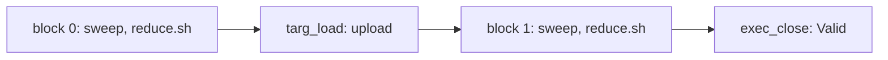
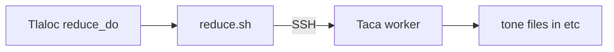
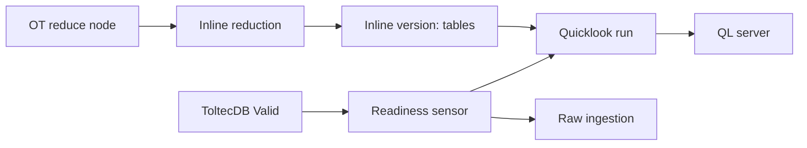

<!-- _class: cover -->
<!-- _paginate: false -->

# Operating TolTEC in v3

Findings and proposals: OT nodes, Tlaloc actions, inline reduction and quicklook

Draft for the detector setup spec update · evidence in toltec-instrument-operations-findings-evidence.md

---
# Contents

[An observing sequence as OT scripts](#3)

[What each OT node does in Tlaloc](#4)

[`Tune Cal` inside Tlaloc](#5)

[Pointing obsnum: Tune, then Lissajous](#6)

[`reduce.sh`: one synchronous request per network](#7)

[Who prepares the next tones](#8)

[Inline cost per network](#9)

[When the operator checks quicklook](#10)

[Quicklook delivery: v2, v3, and reuse](#11)

[Where the quicklook time went](#12)

[Proposed operational flow](#13)

[Quicklook as continuously curated products](#14)

[Triggering quicklook in Dagster](#15)

[Proposed changes to the detector setup spec](#16)

---
# An observing sequence as OT scripts

Recorded 2025-10-31, 10 networks (ToltecDB slice, LMTMC slice, `toltec0` headers):

| OT script | Obsnums | Acquisitions |
|---|---|---|
| `10_toltec_detector_init_coarse` | 145605 | `VnaSweep Cal` |
| `12_toltec_tune_3_iters` | 145606–145608 | `TargSweep Cal` ×2, `Tune Cal` |
| `01_standard_pointing` ×4 | 145609–145612 | scan 1 Tune, scan 2 `Lissajous` (60 s) |

Each pointing obsnum records ObsPgm Tune (scan 1) then Lissajous (scan 2), 57–60 s apart. The operator queries quicklook by obsnum after a script ends.

<!--
Sources: tolteca_ref_data/test_fixtures/toltecdb_slice.sqlite (Date/Time, ObsType),
lmtmc_slice.csv (ObsPgm/ObsGoal), toltec_astro/taco_recipes observing_scripts (main c9e7364).
-->

---
# What each OT node does in Tlaloc

| OT node | `RoachCmd` | Tlaloc action (`main` e967166) |
|---|---|---|
| `VnaSweep Cal` / `TargSweep Cal` | Cal mode | `vna_sweep()` / `targ_sweep()`: acquire one sweep |
| `Tune Cal` | Cal mode (`tune`) | `exec_tune()`: two sweeps, two reductions, one load |
| `ToltecRoachVnaReduce` | `vna_reduce` | `reduce_do()`: run `reduce.sh`, then read the report |
| `ToltecRoachTargReduce` | `targ_reduce` | same as above; no upload |
| `ToltecRoachTargLoadFromFile` | `targ_load_from_file` | read the report, then `targ_load()` uploads tones |
| `ToltecRoachTargLoadAmpsMode` | `targ_load_amps_mode` | select LUT or FILE; no upload |

One manager per network runs these; reductions of different networks run in parallel.

<!--
Cal rows: OT issues "Cal -CalMode VnaSweep|TargSweep|Tune"; the LMT dispatch to Tlaloc is outside our code.
Tlaloc's "tune" command sets trigger_exec_tune (ToltecRoachCommander.cc).
ToltecRoachManager.cc (main): reduce_do L1203, targ_load_from_file L1275, targ_load L1307,
targ_sweep L1623, vna_sweep L1815, targ_read_file L1885, exec_tune L2347; dispatch loop ~L3018–3066.
reduce_do runs "reduce.sh <data_root>/toltecN.nc -r --output <report> --action <a>" via toltec_system and
does not check its status; for VNA and TARG types it then calls targ_read_file() (tones and model into state).
-->

---
# `Tune Cal` inside Tlaloc

| Data | Uploaded comb | Model recorded |
|---|---|---|
| Tune block 0 | previous comb | previous model |
| Tune block 1 | refined comb | block-0 model |
| Next acquisition | same refined comb | block-1 model |

<!--
exec_tune (main L2347-2396): targ_sweep; reduce_do(TARG,0,1); targ_load; targ_sweep; reduce_do(TARG,0,2); exec_close.
The block-1 reduction reads its report (no load), so the block-1 model applies to the next acquisition while the
uploaded comb is unchanged. Detector setup spec §3.4, §10.1.
-->

---
# Pointing obsnum: Tune, then Lissajous

| Event (145609, `toltec0`) | Time (UTC) |
|---|---|
| Tune scan 1 start | 09:26:59 |
| block 0 samples | 09:27:00.0 – 09:27:08.5 |
| block 1 samples | 09:27:36.0 – 09:27:44.4 |
| Tune file `ObsEndTime` (after block-1 reduce) | 09:27:54 |
| Lissajous scan 2 start / first sample | 09:27:57 / 09:28:10.5 |

- No gap between scans by design. The Lissajous uses the Tune's final sweep as calibration.
- The Tune result is not needed before the Lissajous runs.

<!--
Header.Toltec.ObsStartTime/ObsEndTime and Data.Toltec.RecvTime of the two toltec0 files; ToltecDB 145609-0-1/0-2.
User [claude 11-02]: "The tune followed by timestream is written in the OT script and there is no gap on purpose."
-->

---
# `reduce.sh`: one synchronous request per network

Tlaloc waits for <code>reduce.sh</code>, then reads the installed report with <code>targ_read_file()</code>.

| | v2 (production) | v3 (current branch) |
|---|---|---|
| Clip | native v1 `kids` (report not installed) | Python hook: bind request, then install |
| Taca | two Python processes: `dispatch_tlaloc` → `dispatch_tolteca_kids` | one Python worker |
| Computation | SweepCheck, KidsFind, tone output | VNA: same steps; Target/Tune: native fit |

<!--
v2: taco_recipes scripts/tlaloc/bin/reduce.sh, dispatch_tlaloc.{sh,py}, scripts/kids/dispatch_tolteca_kids.{sh,py}.
v3: taco_recipes src/taco_recipes/kids.py (run_hook, run_worker, _run_native), uncommitted v3 branch.
-->

---
# Who prepares the next tones

### Rule

SweepCheck → KidsFind → **TonePrep** prepares tones → **TlalocOutput** installs them.

The native fit supplies the model recorded for subsequent data.

### Current v3 code

`targ_reduce` installs `f_centered = f_out − LO` from the native fit.

`fit_prepare.prepare_fit_tones`, `kids._run_native`; spec §2.1, §9.2, §10.1 say the same.

Finding F1: the v3 Target/Tune path puts the fitter in the tone loop. v2 tones came from KidsFind for every sweep.

<!--
User [claude 11-02]: "the native fit never prepares the next tones. it is done by the roach tone prep step and installed by the tlaloc output step."
tolteca_kids/fit_prepare.py:47 prepare_fit_tones; columns["f_centered"] = f_out - lo.
-->

---
# Inline cost per network

| Measurement | v2 | v3 |
|---|---:|---:|
| One Tune request, end to end (host, no SSH) | ≈ 7.5–8.7 s | 7.0–7.2 s |
| 13 networks, Taca side, 13-way (host) | 18.3 s | 9.3 s |
| 13 networks, Target/Tune block, 7 workers (Docker) | 16.8–20.9 s | 7.3–9.7 s |
| 13 networks, VNA, 7 workers (Docker) | 34.9 s | 13.7 s |
| 10 networks at once, slowest, clip side included: Tune block 1 (Docker) | 9.0 s | 8.2 s |
| Same, v3 saving each call as a version and registering it | — | 21.8 s |
| Same, v3 staging the tables for one version per acquisition | — | 8.4 s |

- Recorded v2 bounds: Tune block 0 → block 1, 27.52 s; block 1 → file close, 9.56 s.
- Inline time adds to the observation; the recorded gaps are outcomes, not deadlines.

<!--
Evidence: python/run/pipeline-overhead-20261102, python/run/v2v3-overhead-20261102 (README).
Docker VM: 12 CPUs, 8 GB; v3 Docker numbers from Codex's inline actor (Python finding, no clip hook).
Burst rows: python/run/inline-full-20261102 (T5); clip side = v2 native kids, v3 hook + native fit; no SSH.
The v3 clip hook (2.1-2.2 s of Python on the clip) takes most of v3's Taca-side gain.
-->

---
# When the operator checks quicklook

| OT script | Last inline call | Operator queries | Content |
|---|---|---|---|
| Coarse init | `VnaReduce`, after the VNA file closes | VNA obsnum | VNA finding |
| Tune iterations | Tune block 1, before the file closes | Tune obsnum | Tune feedback |
| Standard pointing | Tune block 1 | pointing obsnum, after the Lissajous | Tune + pointing |

MC queries one obsnum at a time. v2 stacked the Tune plot with the pointing plots into one image (ql_server, TCP 9876).

<!--
Ordering from exec_tune (reduce before exec_close) and the OT scripts (VnaReduce/TargReduce follow the Cal action).
v2 ql_server.py get_quicklook_response / _vstack_images / _hstack_images.
-->

---
# Quicklook delivery: v2, v3, and reuse

`Valid` = 1 → quicklook available to MC; Docker VM, 13 networks, same replay:

| Acquisition | v2 | v3 as is | v3 reuse |
|---|---:|---:|---:|
| VNA 145605 | 64.7 s | 57.7 s | **20.0 s** |
| Target 145606 / 145607 | 51.3 / 48.6 s | 40.1 / 33.7 s | **14.4 / 12.9 s** |
| Tune 145608 / 145609 | 45.3 / 52.7 s | 51.1 / 49.3 s | **8.9 / 13.3 s** |

v3 reuse: quicklook reads the inline finding tables and registers in its own run. PNGs and feedback.json are byte-identical to v3 as is.

<!--
v2: toltecpipe run end (Dagster 1.6.6), python/run/v2v3-overhead-20261102/v2-run1. v3: v3-base, v3-reuse2.
Experiment code: harness/dagster_reuse.py, harness/inline_actor.py. One run per variant.
-->

---
# Where the quicklook time went

| Change from v2 to v3 | Effect on delivery |
|---|---|
| 18 op subprocesses per run → one in-process asset | v2 quicklook step starts 40–58 s after Valid; v3 run starts at 7–11 s |
| Reuse inline tables → re-reduce every network and block | +16 to +36 s |
| PNG files served from disk → separate DPDB registration run | +6.7 to +11.3 s |
| Inline: two Python processes → one | bursts about 2× faster |

The two regressions cancelled the executor gain, so v3 as is matched v2.

<!--
v2 reduce_ql.py reads *_kids_find.ecsv / *_chan_prop.ecsv from the inline output (waits ≤ 20 s);
v3 tolteca_db/kids_workflow.py kids_quicklook direct mode; kids_quicklook_registered asset.
-->

---
# Proposed operational flow

- Inline: SweepCheck, KidsFind, TonePrep, TlalocOutput; saves the KidsFind and tone tables as a version and registers it; no block Zarr.
- Quicklook collects without recomputing, publishes, and registers its products with the raw records it consumed.

---
# Quicklook as continuously curated products

| Quicklook context | Updated when | Query result over time |
|---|---|---|
| Raw acquisition (scan 1 Tune) | its readiness | Tune feedback |
| Observation (obsnum) | each scan completes | scan-1 Tune first; then pointing + Tune summary |
| Calibration group lineage | each new sweep | lineage since the group's VNA |

- Each update is a new `dp_quicklook` version; the tag moves.
- The QL server returns what is current at query time, without waiting.

Later: the first slice matches v2's quicklook (raw acquisition and pointing map).

<!--
User [claude 11-02]; dp_quicklook decision [kids 10-31 16:55]; spec: version groups and tags.
-->

---
# Triggering quicklook in Dagster

- Sensor loop floor: `MIN_INTERVAL_LOOP_TIME = 5` s in Dagster 1.6.6 and 1.13.20.
- Current Taca: readiness sensor → `raw_obs_available` event → automation sensor → run.
- Direct: the readiness sensor requests the runs in the same tick.

| Acquisition | MC, automation hop | MC, direct trigger |
|---|---:|---:|
| VNA / Targets | 20.0 / 12.9–14.4 s | 18.3 / 12.4–13.5 s |
| Tunes | 8.9–13.3 s | 9.5–11.8 s |

Both paths share the 5 s loop. The direct trigger started raw ingestion earlier (Tune 145609: +1.4 s vs +8.9 s).

<!--
dagster/_daemon/sensor.py MIN_INTERVAL_LOOP_TIME; SensorResult carries asset events and run requests;
_evaluate_sensor reports events before submitting runs. User [kids 10-16 15:50]: toltecdb sensor should directly trigger quick reduction.
-->

---
# Proposed changes to the detector setup spec

1. Every sweep reduction runs SweepCheck, KidsFind, TonePrep and TlalocOutput. The native fit supplies the model only.
2. The inline step saves its high-level tables (KidsFind, tones) as a version and registers it; no block Zarr.
3. Inline time is observation overhead; remove deadline language.
4. Each pointing obsnum begins with a Tune scan; state it.
5. Quicklook first matches v2 (raw acquisition, pointing map), triggered by the ToltecDB sensor and bounded by a timeout; obsnum and lineage products follow.

Answered 2026-11-02: inline saves the version; an inline run request waits on a Dagster concurrency check; the first slice matches v2. Open: one version from per-network calls.

---
<!-- _class: section-title -->

# Appendix

---
# A1 · Measurement scope

| Item | Scope |
|---|---|
| Docker VM | 12 CPUs, 7.75 GB; one stack at a time |
| Inputs | 13 labelled replicas of `toltec0` files per acquisition |
| Cadence | recorded starts at 1×, open loop |
| Not covered | SSH, NFS, hardware upload, native fit in Docker |
| Runs | one per variant; no repeats |

Absolute times overstate production; differences between variants hold.

