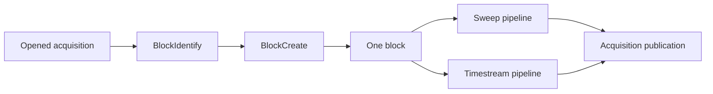
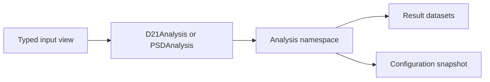

<!-- _class: cover -->
<!-- _paginate: false -->

# KIDs processing and analysis

<p class="subtitle">Blocks, scientific views, checks and configurable artifacts</p>

---
# Contents

<div class="cols">
<div>

[Components](#3)

[Processing flow](#4)

[Identification and creation](#5)

[Acquisition and block scopes](#6)

[Configured block pipelines](#7)

[Sweep reduction and views](#8)

</div>
<div>

[Sweep checks](#9)

[Figures and artifact ownership](#10)

[Timestream and spectral analysis](#11)

[Analysis scopes](#12)

[Step context and persistent results](#13)

[Runner and output](#14)

</div>
</div>

<p class="note"><a href="#15">API and structure reference</a></p>

---
# Components

| Owner | Responsibility |
|---|---|
| `tolteca_datamodels` | Open files, normalize acquisition metadata, identify recorded blocks |
| `tolteca_kids` | Prepare block scopes, reduce, check, generate artifacts and publish |
| `tolteca_kidsproc` | Signal views and reusable D21 / PSD analyses |
| `tollan` | Schema / mapper / view, analysis, steps, artifacts and Viz contracts |
| Runner | Select inputs, iterate interfaces and blocks, group acquisition outputs |

---
# Processing flow

<div class="diagram">



</div>

Each pipeline operates on one block. The runner visits every identified block and collects interface results.

---
# Identification and creation

| Operation | Result | Data access |
|---|---|---|
| Open / `.meta` | Acquisition metadata | Does not construct the block collection |
| `BlockIdentify` | `ToltecBlockIndex` in step context | Explicit LO / tone inspection |
| `BlockCreate` | `raw`, shared tables, `blocks/<id>` scopes | Lazy block selections |
| `.toltec_kids.blocks` | Collection and per-block views | Uses the prepared tree |

<p class="note">Boundary detection follows recorded LO behavior. Mixed future acquisitions still require boundary-policy validation.</p>

---
# Acquisition and block scopes

<pre class="tree">acquisition/                 attrs: acquisition metadata
├── raw/                     native file Dataset
├── blocks/
│   ├── index/               block records
│   ├── chan/                shared channel table
│   ├── probe/               shared probe table
│   └── 0/                   attrs: block + acquisition metadata
│       ├── sweep/           reduced Dataset
│       └── sweep_check/     check result namespace
└── tolteca_kids/             preparation / publication records</pre>

<p class="note">Attribute-only scopes isolate datasets with different coordinates. Per-block processing records belong to their block. Raw selections and selected tables can be reconstructed by views.</p>

---
# Configured block pipelines

```python
from tollan.config import RuntimeContext
from tolteca_kids.core import Kids

kids = Kids(RuntimeContext())
# block is an already prepared raw block scope
kids.sweep_pipeline(block)
```

| Pipeline | Configured operations |
|---|---|
| Sweep | `SweepReduce`, `SweepCheck`, `SweepCheckPlot` |
| Timestream | `TimestreamReduce` |
| No-op | `NoOp` |

Checks and plotting are disabled by default. `Kids` supplies steps and pipelines; runner functions own file and block iteration.

---
# Sweep reduction and views

```python
from tolteca_kids import SweepReduce

SweepReduce()(block)
sweep = block.toltec_kids.sweep
signal = block.kids.s21
```

| Facet | Contents |
|---|---|
| Sweep | I/Q means at each LO step, I/Q population standard deviations |
| Signal | Complex S21 from the same data |
| Metadata | Acquisition identity, block ID, channel and probe axes |
| Dimensions | Channel × sweep step; schema supplies actual dimension names |

<p class="note">The uncertainty is the dwell population standard deviation, not a standard error of the mean.</p>

---
# Sweep checks

```python
from tolteca_kids.sweep_check import SweepCheck

SweepCheck()(block)
checked = SweepCheck.view(block)
flags = checked.bitmask_chan
corrected = checked.sweep
```

- Sample, channel and frequency-chunk quality flags.
- Despiking, sweep statistics, D21 and baseline diagnostics.
- Result datasets and producing settings persist beneath the block.
- The core port targets production v2 numerical behavior.

<p class="note">Readout-power modeling and optional raw-sample PSD from v2 are outside this checker slice.</p>

---
# Figures and artifact ownership

```python
from tolteca_kids.sweep_check_plot import SweepCheckPlot
from tolteca_kids.sweep_check_viz import IQGridViz

figure = IQGridViz(page_size=16)(checked)
SweepCheckPlot()(block)
context = SweepCheckPlot.get_context(block)
```

| Object | Owns |
|---|---|
| `PlotlyViz` subclass | Typed input and figure-construction settings |
| `SweepCheckArtifacts` | Named figures, export and local-display settings |
| `context.artifacts` | Produced objects and their specs |
| `DataProdOutput` | Destination paths and final artifact registration |

The Web viewer uses the same Viz implementations on reopened check results.

---
# Timestream and spectral analysis

| Interface | Contents |
|---|---|
| `.timestream` | One time axis shared by all channels; recorded sampling frequency |
| `TimestreamReduce` | I/Q, optional supplied r/x, amplitude and phase spectra |
| `PSDAnalysis` | Welch PSD per channel; optional frequency-band statistics |
| Common spectrum | Median and scaled MAD across channel spectra |
| Signal-only reduction | Set `kids.timestream_reduce.psd: null` |

<p class="note">PSD requires complete uniform samples at the supplied rate. Gap repair and irregular sampling belong to input preparation. This Python path does not solve raw I/Q into r/x.</p>

---
# Analysis scopes

<div class="diagram">



</div>

- `analysis(view)` prepares a standalone tree with retained input.
- `analysis(view, output=block)` installs into the supplied block scope.
- `.kids.d21` and `.kids.psd` expose result views and saved configurations.
- Schema subpaths locate datasets within the analysis namespace.

---
# Step context and persistent results

| State | Lifetime |
|---|---|
| `context.config` | Effective step settings |
| `context.data` | Live typed result view for following steps |
| `context.artifacts` | Live figures and export specifications |
| `completed`, `failures` | Structured execution outcome |
| Zarr datasets / saved step records | Persistent arrays and serialized execution metadata |

<p class="note">Reopening Zarr recreates data views, not live contexts. Sequential operations inspect their own prerequisites and record failures. File resources must remain open for lazy reads.</p>

---
# Runner and output

```python
from tolteca_kids.runner import run_data, run_source

working = run_data(ds, source_path, runtime)
index_path = run_source(source_path, runtime)
```

| Entry point | Ownership |
|---|---|
| `run_data` | Caller owns open input; returns the working tree |
| `run_source` | Opens and closes one file; returns its published index or None |
| `run_inputs` | Prepared model table; processes and groups selected interfaces |
| `publish_quicklook` | Shared CLI / automation workflow for prepared feedback |

<p class="note">One processed acquisition Zarr has interface children even for one interface. Publication and inventory details have separate decks.</p>

---
<!-- _class: section-title -->
# API and structure reference

Detailed interfaces and data layouts

---
# D21 analysis

<div class="cols">
<div>

### High-level workflow

```python
analysis = D21Analysis()
analysis(scope.kids.sweep, output=scope)
view = scope.kids.d21
```

### Individual calculations

```python
matched = analysis.make_matched(
    scope.kids.sweep
)
unified = analysis.make_unified(
    scope.kids.sweep
)
```

</div>
<div>

| View property | Result |
|---|---|
| `.d21` | Complex dS21/df on measured grid |
| `.d21_unified` | Mean derivative magnitude on common grid |
| `.f_unified` | Common frequency grid |
| `.cov_unified` | Contributing channel count |
| `.d21_analysis` | Producing configuration |

<p class="note">NumPy/Dask input; eager computation.</p>

</div>
</div>

---
# PSD analysis

<div class="cols">
<div>

### High-level workflow

```python
analysis = PSDAnalysis(
    nperseg=128,
    stat_f_lims=(8*u.Hz, 32*u.Hz),
    compute_common=True,
)
result = analysis(source.kids.timestream)
view = result.kids.psd
```

### Generic series calculation

```python
spectra = analysis.make_psd(
    series,
    dim="sample",
    f_smp=128 * u.Hz,
)
```

</div>
<div>

| View property | Reduction |
|---|---|
| `.psd` | Welch spectrum per channel |
| `.psd_median` | Median across frequency band |
| `.psd_mad_std` | Scaled MAD across frequency band |
| `.psd_common` | Median across channel spectra |
| `.psd_common_mad_std` | Scaled MAD across channel spectra |
| `.psd_analysis` | Producing configuration |

<p class="note">Complete uniform samples at the recorded rate. Lazy computation uses the full selected time span per channel batch.</p>

</div>
</div>

---
# Numerical inputs, coordinates and units

```python
sweep_ds = make_kids_dataset(I, Q, frequency=frequency * u.Hz)
time_ds = make_kids_dataset(I, Q, f_smp=128 * u.Hz)
```

| Input / output | Contract |
|---|---|
| I/Q | `(sample,)` or `(chan, sample)` |
| Sweep frequency | Full I/Q shape, frequency quantity |
| Time | One-dimensional quantity, shared by channels |
| Time or rate | Derive the other from regular sampling; validate when both supplied |
| PSD units | Input `.u` units squared per Hz; unitless input gives Hz⁻¹ |
| D21 units | Current output labels Hz⁻¹; input signal units are not propagated |

---
# Analysis destinations

<div class="cols">
<div>

### Standalone result

```python
result = PSDAnalysis()(time_ds.kids.timestream)
```

<pre class="tree">/ <b>[S]</b>
├── _input <b>[D]</b>
└── tolteca_kidsproc.analysis.psd <b>[S]</b>
    └── psd <b>[D]</b></pre>

Original data at `_input`; new DataTree.

</div>
<div>

### Existing block scope

```python
result = PSDAnalysis()(
    tree["blocks/0"].kids.timestream,
    output=tree, parent_namespace="blocks/0",
)
assert result is tree
```

Input stays at `blocks/0/timestream`.<br>`output=tree["blocks/0"]` also works.

</div>
</div>

<p class="note"><b>[S]</b> scope: no variables, coordinates or dimensions, including inherited ones. <b>[D]</b> dataset: independent axes permitted.</p>

---
# Analysis configuration and reuse

| API / behavior | Contract |
|---|---|
| `.d21.d21_analysis` / `.psd.psd_analysis` | Producing configuration, stored in namespace attributes |
| Existing result | Reuse when configuration and required result checks match |
| Changed input values | Use `force=True`, then reacquire the view |
| Result installation | Replace the analysis namespace; retain sibling data and analyses |

```python
analysis(scope.kids.sweep, output=scope, force=True)
view = scope.kids.d21
```

<p class="note">Reuse does not compare input values. PSD also compares the recorded sample rate and sample count.</p>
