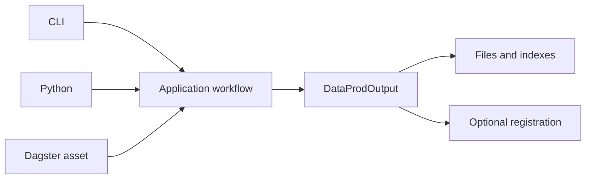
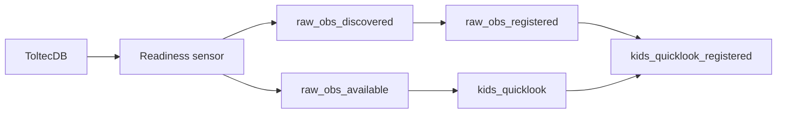
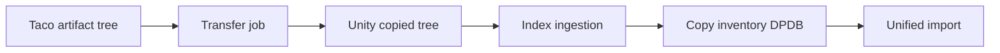

<!-- _class: cover -->
<!-- _paginate: false -->

# Operational workflows

<p class="subtitle">CLI and Python operations, asset topology and asynchronous feedback</p>

---
# Contents

<div class="cols">
<div>

[Workflow entry points](#3)

[Invocation and ownership](#4)

[Configuration ownership](#5)

[Raw ingestion and quicklook triggers](#6)

[Manual KIDs workflow](#7)

[Partitioned processing assets](#8)

</div>
<div>

[Quicklook API](#9)

[Transfer workflow](#10)

[Unified inventory workflow](#11)

[Publication and recovery boundaries](#12)

[Service-owned workflow recipes](#13)

[Automation and manual operations](#14)

</div>
</div>

---
# Workflow entry points

| Workflow | Inputs | Outputs |
|---|---|---|
| Acquisition ingestion | ToltecDB records / discovered files | Raw products and intrinsic associations |
| KIDs quicklook | Selected acquisition files | Reduced blocks, checks, feedback artifacts |
| Index registration | Committed product indexes | DPDB product/run/source/association records |
| Transfer | Source product tree | Copied tree and its independent inventory |
| Unified import | Source inventory journals | Separate unified DPDB |
| Web / MC query | DPDB selector | Existing records and artifact URLs |

---
# Invocation and ownership

<div class="diagram">



</div>

A workflow defines processing for its input collection. The caller supplies discovery and execution. CLI publication can operate without a DPDB.

---
# Configuration ownership

| Root section | Owner | Contains |
|---|---|---|
| `input_discovery` | Input handler | Stores, sources, selectors and population mode |
| `kids` | KIDs handler | Step, artifact and publication configuration |
| `db` | Database handler | Named connections and setup |
| `data_prod` | Product handler | Ingest / index / association / unify / driver roles |
| `web` | Web handler | Query bind and service endpoints |
| `execution` | Deployment execution handler | Compute targets, profiles and permitted overrides |

One root subkey per handler. Nested typed configuration supplies operation-specific roles; handlers compose through the runtime.

---
# Raw ingestion and quicklook triggers

<div class="diagram">



</div>

<p class="note">Record discovery and local-file readiness are separate. Quicklook computation does not wait for ingestion. Registration can depend on both when enabled.</p>

---
# Manual KIDs workflow

```console
tolteca_kids --config_paths workflow.yaml \
  --kids.sweep_check.enabled=true \
  --kids.quicklook.enabled=true \
  --kids.output.enabled=true \
  --kids.output.registration=false
```

- `input_discovery` supplies the collection of candidate files.
- The runner opens and selects applicable input rows.
- Every identified block uses the configured data-kind pipeline.
- Output groups selected interfaces under their acquisition.
- Registration can run now or later from committed indexes.

---
# Partitioned processing assets

```python
from tolteca_db.kids_workflow import make_definitions

defs = make_definitions(runtime)
```

| Asset | Partition / role |
|---|---|
| `raw_obs_discovered` | Dynamic `uid_raw_obs`, recorded acquisition |
| `raw_obs_available` | Same partition, usable files |
| `raw_obs_registered` | Independent inventory materialization |
| `kids_quicklook` | Scientific publication |
| `kids_quicklook_registered` | Pinned output registration |

<p class="note">Manual materialization accepts explicit sources. Declarative automation and readiness sensors are independently enabled.</p>

---
# Quicklook API

```text
GET /api/ql?obs_spec=145609
GET /api/ql?obs_spec=tcs-145609-0-1
```

- MC can request one observation number at a time.
- The API accepts the broader ObsSpec vocabulary.
- Feedback JSON contains links to prepared plot artifacts.
- Processing runs independently while later observations acquire.
- Unready products return state; the request does not run reduction.
- Optional Dagster status checks are bounded and separate from artifact reads.

<p class="note">FastAPI serves feedback and artifact endpoints. The Web portal is a separate Dash application.</p>

---
# Transfer workflow

<div class="diagram">



</div>

Transfer has its own sensor and job. The current transport uses rsync tree traversal. The copy inventory evolves independently of live Taco and Unity’s native processing inventory.

---
# Unified inventory workflow

<div class="cols"><div>

### Dagster code location

```python
from tolteca_db.inventory_workflow import (
    make_definitions,
)

defs = make_definitions(runtime)
```

### CLI invocation

```console
tolteca_db index unify \
  --config_paths workflow.yaml
```

</div><div>

| Element | Contract |
|---|---|
| `operational_inventory` | Source asset; partition per inventory |
| `unified_inventory` | Import committed registrations |
| `registration_readiness` | Compare journal with import progress |
| `unify_inventory` | Manually launchable asset job |

</div></div>

<p class="note">Destination DPDB progress controls replay. Manual CLI commits appear in the source journal too.</p>

---
# Publication and recovery boundaries

| Failure / action | Recovery unit |
|---|---|
| Scientific computation fails | Retry according to execution policy |
| Files committed, registration fails | Register the same pinned indexes |
| Unified import page fails | Resume after committed destination sequence |
| Slurm supervisor interrupted | Reattach the exact retained attempt |
| New processing request | Create a new run realization |

Workflow run UUID, Dagster run ID, Slurm job ID and human-readable run name have distinct roles. The execution adapter records their relationship.

---
# Service-owned workflow recipes

<pre class="tree">tolteca_web package
└── data/location/run/tolteca_web.default/
    ├── config.d/00_default.yaml
    ├── justfile
    ├── just.d/00_default.just
    ├── dagster_kids.py
    └── dagster_inventory.py</pre>

| Recipe | Application operation |
|---|---|
| `quicklook_reduce` | KIDs checker, feedback, publication and registration |
| `index_ingest`, `inventory_unify` | Register indexes or import inventories |
| `web_portal`, `quicklook`, `inventory_api` | Start independent query services |

<p class="note">tolteca_deploy projects package-owned profiles into a location and applies local overrides.</p>

---
# Automation and manual operations

| Operation | Shared boundary |
|---|---|
| Taco acquisition and quicklook | Independent operational Dagster instance |
| Unity transfer / reduction / inventory | One instance can host separate code locations |
| Manual processing | Same CLI workflows, own requested run and tag |
| Manual QA | Compute allocation for heavy work; configured DPDB connection |
| Web viewing | Existing product records and published artifacts |

Code locations separate environment and release lifecycles. Execution profiles select compute placement. The deployment deck describes submission and resource policy.
