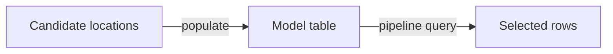
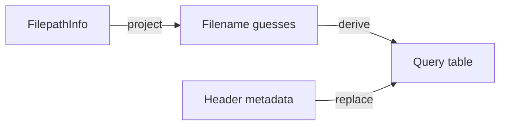
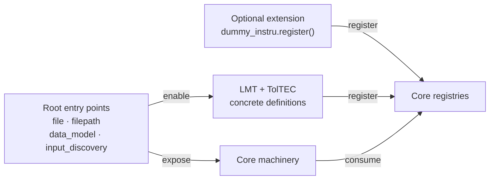
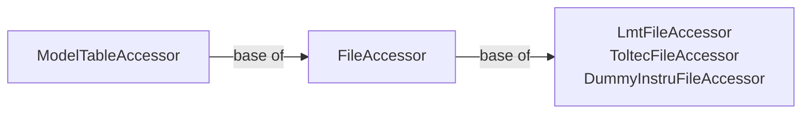
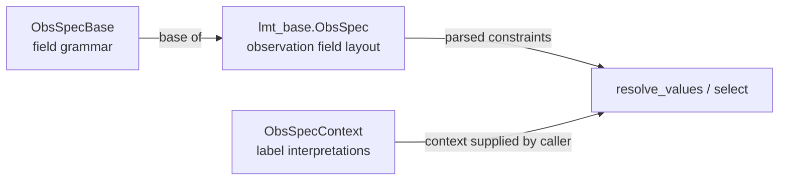
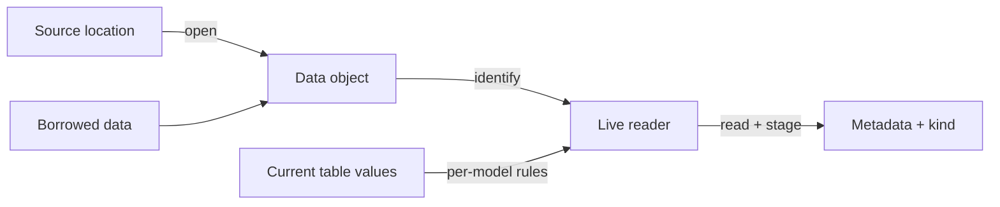

<!-- _class: cover -->
<!-- _paginate: false -->

# Input discovery and data access

<p class="subtitle">File stores, observation selection, readers and pipeline handoff</p>

---
# Contents

<div class="cols">
<div>

[Package and instrument boundaries](#3)

[Input workflow](#4)

[Resource and acquisition identity](#5)

[File stores](#6)

[Configured input discovery](#7)

[Population modes and authority](#8)

</div>
<div>

[Querying observations and flags](#9)

[Opening a selected table](#10)

[Schemas, mappers, accessors and metadata](#11)

[KIDs acquisition inspection](#12)

[HWPR and KIDs share observation identity](#13)

[Pipeline-owned input selection](#14)

</div>
</div>

<p class="note"><a href="#15">API and structure reference</a></p>

---
# Package and instrument boundaries

| Layer | Responsibility |
|---|---|
| `tollan` | Configuration, FileLoc, model-table projection/query, schemas and accessors |
| `tolteca_datamodels.core` | Import-neutral filename, source, store, discovery and selector machinery |
| Root entry points | Assemble built-in support for `file`, `filepath`, `data_model`, `input_discovery` |
| `lmt_base` | Common LMT observation identifiers, field types and metadata |
| `lmt` | Telescope state: pointing, tracking, observing program and goal |
| `toltec` | Instrument acquisitions: KIDs readouts and HWPR state |
| Individual pipelines | Select prepared inputs, perform analysis and publish products |

<p class="note">LMT records telescope state alongside each instrument. <code>toltec_file</code> includes TolTEC's telescope companions because its reduction needs both.</p>

---
# Input workflow

<div class="diagram small">



</div>

| Stage | Work performed |
|---|---|
| Discovery | Resolve configured locations; use ObsSpec to narrow store searches |
| Table population | Project filename information; compute UIDs and guessed data kinds |
| Metadata enrichment | Open supported sources and replace guessed observation values |
| Input selection | Evaluate each pipeline's query on the opened table |

<p class="note">The input workflow ends with table selection. Discovery may read headers early. Explicit KIDs block inspection is a separate reader API, outside this flow.</p>

---
# Resource and acquisition identity

| Value | Meaning |
|---|---|
| `source` | Resource to open, such as `/cache/a.nc`; open objects accepted |
| `source_loc` | FileLoc for filename identification: `archive:/data_lmt/tel/tel_…nc` |
| `filepath_orig` | Acquisition path recorded in the header |
| `filepath_info_orig` | Parsed acquisition path: prefix, sequence numbers, writer time |

```python
cached = LmtFileAccessor.from_sources([
    {"source": tel_path, "source_loc": remote_name}
], mode="read")
```

<p class="note">An omitted <code>source_loc</code> uses <code>source</code>; open handles require an explicit location. Location columns expose locality, host and scheme. Header paths are provenance; writer time is separate from observation time.</p>

---
# File stores

<div class="cols">
<div>

<pre class="tree">data_lmt/                 LmtFileStore
├── tel/                  telescope state
│   └── tel_toltec_…nc
└── toltec/               ToltecFileStore
    ├── tcs/
    │   ├── toltec0/
    │   ├── toltec7/
    │   └── hwpr/
    └── ics/</pre>

</div>
<div>

- LMT owns `tel`; TolTEC owns its root and renders fixed-depth acquisition globs.
- `store.tel.path`, `store.toltec.path` expose concrete directories.
- `partial()` returns a view without changing the store.
- `iter_glob_patterns(spec)` exposes root-relative patterns without filesystem I/O.

</div>
</div>

```python
store = LmtFileStore(data_lmt_path)
S = type(store)
view = store.partial(S.tel, S.toltec)
paths = view.glob_obs_spec("tcs-145609/{tel,0}")
table = ToltecFileAccessor.from_sources(paths, mode="guess")
selected = table.toltec_file.query_obs_spec("tcs-145609/{tel,0}")
```

<!-- Store discovery preserves enumeration order and removes duplicate lexical paths without sorting or resolving symlinks. Each store uses its own ObsSpec context only for its local locations. Store globs do not apply positional selection. partial(exclude=(S.tel,)) selects all but telescope; partial() with no selection raises. Typed store.substores[ToltecFileStore] retrieves the eagerly constructed child. -->

---
# Configured input discovery

<div class="cols">
<div>

```yaml
input_discovery:
  data_model_select: [toltec]
  inputs:
    - data_lmt_path: /data/data_lmt
      obs_spec: 'tcs-145609/{tel,0}'
      mode: guess
    - data_toltec_path: /data/data_lmt/toltec
      obs_spec: 'tcs-156755/{7,11,hwpr}'
      mode: read
    - sources:
        - {glob: '/cache/tel/*.nc'}
      data_model_select: [toltec]
      mode: guess_or_read
```

</div>
<div>

### Capability selection

- Task context → global selection → per-entry selection: each can only narrow.
- Selected data models choose store locations and table enrichment/readers.
- Each entry builds and filters its table before combination and deduplication.
- Relative paths use the runtime's `root_path`.

</div>
</div>

<p class="note">Selectors accept exact lists, <code>{includes: […]}</code>, <code>{excludes: […]}</code>, or <code>{pattern: …}</code>; a string is a full-match regex. Sources use literal FileLoc values or explicit local globs; no matches is empty.</p>

<!-- The identifying key chooses a registered configuration model, with no type key. Without a task context, registered data models are available. Both selection fields default to all available support. CLI KIDs supplies a TolTEC context before discovery. Glob * is one directory level; ** enables recursive matching. Concatenation does not reclassify an entry using capabilities it did not select. -->

---
# Population modes and authority

| Mode | Filename parsing | Header reads during construction |
|---|---|---|
| `guess` | Attempt every location | None |
| `guess_or_read` | Attempt every location | Only unrecognized filenames |
| `read` | Attempt every location | In-scope recognized filenames, plus unrecognized filenames |

Known foreign rows stay unopened.

<div class="diagram small">



</div>

<p class="note">Header metadata replaces observation guesses, including nulls. Resource and <code>file_*</code> evidence remain.</p>

<!-- Store inputs default to guess; explicit sources default to guess_or_read. Filename parsing is universal. Derived handlers may contribute cooperatively; they do not choose an exclusive owner. Header recognition independently selects a reader and authoritatively replaces covered values and classifier guesses. Known out-of-scope filenames are not opened; read does not promise inspecting contradictory content behind such a filename. -->

---
# Querying observations and flags

```python
full = ToltecFileAccessor.from_sources(all_paths, mode="read")
pointing = full.toltec_file.query(
    'obs_goal == "pointing" and obs_pgm == "lissajous"'
)
sky = pointing.toltec_file.query(
    "70 < target_ra_deg < 80 and 60 < target_dec_deg < 70"
)
sweeps = full.toltec_file.query("bits_any_set(data_kind_toltec, raw_sweep)")
science = full.toltec_file.query(
    "bits_any_set(data_kind_toltec, raw_sweep | raw_timestream)"
)
```

- Pandas expressions operate on flat columns, with the Python query engine.
- `raw_sweep` includes `vnasweep`, `targsweep` and `tune`.
- `bits_any_set` tests overlap; `bits_all_set` requires the whole mask.

<!-- Query expressions are trusted Python input, not a sandbox. Concrete TolTEC classification gives foreign and unidentified rows the unknown flag. -->

---
# Opening a selected table

```python
with selected.toltec_file.open(update_from_metadata=True) as opened:
    telescope = opened.toltec_file.query('interface == "tel"')
    for row in telescope.itertuples(index=False):
        if row.accessor_obj is None:
            continue
        az = row.accessor_obj.az.isel(time=slice(0, 100)).load()
```

| Resource | Ownership and lifetime |
|---|---|
| File opened by the scope | Each distinct local path opens once; closes on exit |
| Supplied Dataset or DataTree | Borrowed; not closed by the accessor |
| `io_obj` / `accessor_obj` | Resource / identified reader; both removed on exit |
| File-backed arrays | Load needed values before the owner closes the source |
| Header-populated columns | Remain available after the scope closes |

<p class="note">Plain <code>open()</code> stops after identification. <code>update_from_source_metadata()</code> reads and projects metadata; <code>metadata_read</code> skips completed rows unless <code>force=True</code>. The input table is unchanged.</p>

<!-- FileAccessor(selected).open() provides the same ownership contract for mixed tables. Format rules select an opener per row: NetCDF uses xarray; ECSV uses QTable.read. A format opener does not by itself supply domain metadata support. Successful identification followed by a metadata failure retains the opened object in record mode. -->

---
# Schemas, mappers, accessors and metadata

<div class="diagram small">
<svg viewBox="0 0 1148 180" role="img" aria-label="Schema keys and a source layout determine mapper bindings. Accessors and views use those bindings to read metadata and arrays." xmlns="http://www.w3.org/2000/svg">
<defs><marker id="binding-arrow" markerWidth="7" markerHeight="7" refX="6" refY="3.5" orient="auto"><path d="M0,0 L7,3.5 L0,7 Z" fill="#007c83"/></marker></defs>
<g fill="#f4f7fa" stroke="#dce4eb"><rect x="1" y="15" width="175" height="60"/><rect x="330" y="15" width="180" height="60"/><rect x="660" y="15" width="200" height="60"/><rect x="972" y="15" width="175" height="60"/><rect x="298" y="120" width="244" height="54"/></g>
<g fill="#17283d" font-family="Arial, Helvetica, sans-serif" font-size="24" text-anchor="middle"><text x="88" y="52">Schema</text><text x="420" y="52">Mapper</text><text x="760" y="52">Accessor / views</text><text x="1059" y="41">Metadata</text><text x="1059" y="66">and arrays</text><text x="420" y="155">Dataset / tree node</text></g>
<g stroke="#007c83" stroke-width="2" fill="none" marker-end="url(#binding-arrow)"><path d="M176,45 H330"/><path d="M510,45 H660"/><path d="M860,45 H972"/><path d="M420,120 V75"/></g>
<g fill="#516276" font-family="Arial, Helvetica, sans-serif" font-size="21" text-anchor="middle"><text x="252" y="31">keys</text><text x="585" y="31">bindings</text><text x="915" y="31">read</text><text x="496" y="101">probe layout</text></g>
</svg>
</div>

| Component | Contract |
|---|---|
| Schema | Domain vocabulary for native variables, dimensions and attributes |
| Mapper | Bind that vocabulary to a file layout; reusable across sources of the same layout |
| Accessor / view | Present typed domain operations against the supplied data source |
| Metadata | Validated observation facts, independent of how they were acquired |

<p class="note">Mapper reuse shares structural bindings, not file values or metadata caches. A Dataset or the current DataTree node is the native input; readers do not assume an implicit <code>raw</code> child.</p>

---
# KIDs acquisition inspection

```python
with open_toltec_kids(tune_path) as ds:
    acquisition = ds.toltec_kids.meta
    prepared = ds.toltec_kids.block_index
    block_rows = prepared.meta.block_index_table
    channels = prepared.meta.chan_axis_table
    probes = prepared.meta.probe_axis_table
```

| Request | Work performed |
|---|---|
| Open and identify | Recognize a KIDs acquisition or supported processed payload |
| Raw `.meta` | Acquisition identity, readout settings and dimension counts |
| `.block_index` | Delegate to KIDs `BlockIdentify`; inspect LO/tone axes |
| Axis table properties | Materialize QTable views of the prepared columnar axes |

<p class="note">This explicit, cached reader request is separate from input discovery and table selection. It creates no processing blocks and reads no detector I/Q or ADC arrays.</p>

---
# HWPR and KIDs identity

| Observation | Interfaces | Native metadata |
|---|---|---|
| `tcs-156755-0-1` | `toltec7`, `toltec11` | Tune readouts; two identified blocks per file |
| `tcs-156755-0-2` | `toltec7`, `toltec11` | Nominal KIDs readouts |
| `tcs-156755-0-2` | `hwpr` | HWPR readout, 131 packets at 2 Hz |

```python
with open_toltec_hwpr(hwpr_path) as ds:
    hwpr_meta = ds.toltec_hwpr.meta
    encoder = ds.toltec_hwpr.enc_val.isel(time=slice(0, 5)).load()
```

- Native `readout_code`: KIDs and HWPR; `roach`: boards 0–12 only.
- HWPR exposes encoder, zero-point, PPS and sensor arrays with native timestamps.

<p class="note">Shared observation identity does not imply time alignment or polarization calibration.</p>

---
# Pipeline-owned input selection

<div class="cols">
<div>

```yaml
kids:
  input:
    select: 'bits_any_set(data_kind_toltec, raw_sweep)'
    raise_on_errors: true
```

```python
with full.toltec_file.open() as live:
    inputs = Input(InputConfig(
        select="bits_any_set(data_kind_toltec, raw_sweep)",
        raise_on_errors=True,
    )).select(live)
```

</div>
<div>

### Handoff contract

- The shared table is already opened and header-populated.
- Each pipeline owns its query and validates only its selected rows.
- Consumers receive row attributes plus live `io_obj` resources.
- Selection does not open, close or reduce data.

</div>
</div>

<p class="note">KIDs consumes <code>data_kind_toltec</code>, also available in mixed tables. HWPR is readable but is not a KIDs reduction input; block inspection is not an automatic input step.</p>

---
<!-- _class: section-title -->
# API and structure reference

Detailed interfaces and data layouts

---
# Registry, scoped tables and typed readers

| Entry point | Scope chosen by | Result |
|---|---|---|
| `FileAccessor.from_sources(...)` | Registered data models | All enabled enrichment/readers |
| `LmtFileAccessor.from_sources(...)` | LMT declarations | Telescope enrichment/readers |
| `ToltecFileAccessor.from_sources(...)` | TolTEC declarations | KIDs, HWPR and TolTEC telescope readers |
| `FileAccessor.partial(accessor_types=...).from_sources(...)` | Selected data-model definitions | Selected enrichment/readers and ObsSpec query |
| `open_lmt_tel(...)`, `open_toltec_kids(...)`, `open_toltec_hwpr(...)` | The named reader | Dataset with the corresponding typed accessor |

<p class="note"><code>from_sources</code> retains supplied rows and uses universal filename parsing. Handling scope controls enrichment and reading; it does not itself filter rows.</p>

<p class="note">Concrete accessors choose their own handling support. Typed <code>open_*</code> functions expose one resource through its domain accessor.</p>

---
# Neutral core and assembled entry points

<div class="diagram">



</div>

- `core.*` supplies extension building blocks without importing instruments.
- Root workflow imports register built-in definitions; filename imports enable parsers only.
- Concrete classes remain directly usable without a discovery context.

<p class="note">Root and core expose the same <code>FileAccessor</code> class. Import neutrality does not isolate registrations: core consumers see support loaded later.</p>

---
# FileAccessor customization

<div class="diagram small">



</div>

| Customization | Class declarations / hooks |
|---|---|
| Handling identity | `FileAccessor[ToltecDataModel]` infers `data_model_cls` |
| Metadata projection | `_metadata_columns` |
| Identify and read | `_reader_rules`: current-value rules and allowed reader specs |
| Derived values and kinds | `_guess_derived_columns()`, `_data_kind_mapper`, `_data_kind_column` |
| Query syntax and interpretation | `_obs_spec_cls`, `_obs_spec_context`, `_query_namespace` |

<p class="note"><code>ToltecDataModel(DataModelInfo)</code> identifies the declaring model. Row <code>data_models</code> lists compatible models. A <code>DataModelSpec</code> definition connects the accessor and stores; it is constructed only on explicit import.</p>

---
# Universal filename parsing

| Declaration | Effect |
|---|---|
| `register_filepath_parser(...)` | Associate a pattern, ordered parsers and result class |
| Model fields and validators | Validate captures and parser results; generate column projections |
| Multiple matching patterns | Most-specialized result class wins; unrelated ambiguity raises |
| Telescope specialization | Thin TolTEC/dummy subclasses extend the general LMT result class |

```python
info = FilepathInfo.from_source(tel_path)
assert info.data_models == ["lmt", "toltec"]
```

<p class="note">Use the public factory; concrete classes such as <code>LmtFilepathInfo</code> remain public for type checks. Parsing opens no files and ignores table-handling scope.</p>

---
# ObsSpec layout and interpretation

<div class="diagram small">



</div>

| Context for `ObsSpec.parse("*/1")` | Number 1 means | Example caller |
|---|---|---|
| LMT | No numbered telescope interface | `LmtFileAccessor` |
| LMT + TolTEC | `toltec1` | `ToltecFileAccessor` |
| LMT + dummy | `chan01` | `DummyInstruFileAccessor` |
| All enabled accessor contexts | `toltec1` and `chan01` | Generic `FileAccessor` |

<p class="note">Layout hooks define field constraints and the primary field. Private contexts use <code>field_label_numbers={field: {label: number_or_None}}</code>; this is not a label allowlist.</p>

<!-- Each store interprets only its managed locations; child stores keep their own contexts. Table accessors combine the enabled interpretations for the full query. All current instrument accessors use the shared lmt_base.ObsSpec layout. -->

---
# Enabling registered support

```python
from tolteca_datamodels.data_model import data_models, DataModelSet
from tolteca_dummy_instru import register

register()  # Optional extension; the root workflow import enables LMT/TolTEC.
assert data_models.toltec is data_models["toltec"]
toltec_context = DataModelSet.from_select(["toltec"])
```

| Registration | Generic behavior |
|---|---|
| Instrument `data_model.py` | Constructs the definition on explicit import |
| `DataModelSpec(...).register()` | Add one uniquely named capability definition |
| `data_models.lmt`, `.toltec`, `[name]` | Read-only live lookup of registered definitions |
| `DataModelSet.from_select(...)` | Snapshot selected capabilities for a workflow |

<p class="note">Keyed data-model, discovery-input and substore registries reject duplicate registrations. Ordered filename parsers and format openers keep their own matching contracts.</p>

---
# Public entry points and extension machinery

<div class="cols">
<div>

### Application imports

<pre class="tree">tolteca_datamodels/
├── data_model.py
│   └── data_models, DataModelSet
├── filepath.py
│   └── FilepathInfo
├── file.py
│   └── FileAccessor
└── input_discovery.py
    └── InputDiscovery, config</pre>

</div>
<div>

### Extension imports

<pre class="tree">tolteca_datamodels/core/
├── data_model.py   definitions / selection
├── filepath.py     parser registration
├── file/           table workflow
├── source/         openers / reader rules
├── file_store/     descriptors / views
├── input_discovery/ entries / registration
├── obs_spec/       grammar / interpretation
└── types.py        shared model contracts</pre>

</div>
</div>

<p class="note">Instrument packages supply concrete definitions. Tollan owns the reusable model-table, query and keyed-registry utilities. Data-product module organization is outside this change.</p>


---
# Data-model context in discovery

| Selection | Locations searched in an LMT tree | Handling support |
|---|---|---|
| `[lmt]` | Telescope locations only | Telescope metadata |
| `[toltec]` | Telescope + TolTEC locations | TolTEC companions, KIDs, HWPR |
| `[dummy_instru]` | Telescope + dummy locations | Dummy companions and counts |
| All registered | Union of required locations, once each | All enabled classifiers/readers |

```python
scoped_store = LmtFileStore(data_lmt_path).partial(
    store_types=toltec_context.file_store_types)
scoped_paths = scoped_store.glob_obs_spec("*")
scoped_files = FileAccessor.partial(
    accessor_types=toltec_context.file_accessor_types)
scoped_table = scoped_files.from_sources(scoped_paths, mode="guess")
```

<p class="note">Store requirements do not enable extra handlers. Telescope locations can contain foreign companions; filename evidence is retained, while header reads follow the selected scope.</p>

<!-- The selected accessor view retains handlers for both table creation and later operations. -->

---
# Producing instrument and data-model membership

| Filename prefix | `instru` | `data_models` | `interface_kind` |
|---|---|---|---|
| `toltec7` | `toltec` | `["toltec"]` | `roach` |
| `hwpr` | `toltec` | `["toltec"]` | `hwpr` |
| `tel_toltec` | `lmt` | `["lmt", "toltec"]` | `tel` |
| `tel_dummy_instru` | `lmt` | `["lmt", "dummy_instru"]` | `tel` |

- `instru` identifies the producer; `data_models` names applicable handling support.
- Telescope metadata reads `Header.Dcs.Receiver`, normalized to lowercase.
- One telescope record can belong to LMT and its instrument's data model.

<p class="note">Membership is not a reader-priority list. LMT's typed reader is telescope-wide; TolTEC restricts that same reader to its companion files. Header evidence can recover a renamed source.</p>

---
# Generic table API

```python
mixed = FileAccessor.from_sources(mixed_sources, mode="guess")
mixed_sweeps = FileAccessor(mixed).query(
    "bits_any_set(data_kind_toltec, ToltecDataKind.raw_sweep)"
)
mixed_counts = FileAccessor(mixed).query(
    "bits_any_set(data_kind_dummy_instru, DummyInstruDataKind.counts)"
)
mixed_read = FileAccessor(mixed).update_from_source_metadata()
```

| Classifier | Column in both generic and concrete tables |
|---|---|
| TolTEC | `data_kind_toltec` |
| Dummy instrument | `data_kind_dummy_instru` |
| Unmatched row | Each enabled classifier's own `unknown` flag |

<p class="note">There is no combined kind column: equal bits across instruments are unrelated. Concrete accessors also accept bare constants. Membership query: <code>contains(data_models, "toltec")</code>.</p>

<!-- mixed_sources contains actual telescope, KIDs and HWPR locations plus temporary dummy acquisition/companion files and one unrecognized remote filename. See the executable probe. -->

---
# ObsSpec: syntax and context

| Selector | Meaning in a TolTEC + LMT context |
|---|---|
| `tcs-145609-0-2` | A complete observation quartet |
| `145609/{tel,0}` | Telescope and TolTEC 0; no master constraint |
| `tcs-(145605,145612)/tel` | Half-open observation bounds, telescope only |
| `156755/toltec(7,12)` | TolTEC interfaces 7 through 11 |
| `156755/(7,12)` | Numeric interfaces 7 through 11 in the supplied context |
| `tcs-[-1]/tel` | Largest distinct TCS obsnum after value filtering |

<p class="note">The parser records literals, sets, numeric bounds and positions. The store or accessor supplies <code>ObsSpecContext</code> to interpret interface labels.</p>

<p class="note">Value constraints run first. Positions operate on sorted distinct numeric values; they do not inspect file dates. <code>[-1]</code> is not “latest observation across masters.”</p>

<!-- Whole-field * and empty sets accept all values; empty numeric bounds are numeric-only. Numeric constructs can occur within literal labels. Current selection allows one nontrivial positional selector across fields. An unordered resolved label collection cannot establish numeric ordering. -->

---
# Filename models and flat tables

| API or value | Role |
|---|---|
| `FilepathInfo.from_source(...)` | Parse a location into the concrete model registered for its filename pattern |
| Private concrete result classes | Validate captures and derived instrument/observation information |
| `file_prefix`, `file_ut`, `file_obsnum`, … | Projected filename evidence |
| `interface`, `master`, `obsnum`, … | Best available observation information, later replaceable by metadata |
| `quartet`, `uid_raw_obs`, `uid_raw_obs_file` | Computed identifiers when enough observation information is available |

<p class="note"><code>tel_toltec</code> and <code>tel_toltec2</code> are filename prefixes for the same <code>tel</code> interface. The <code>file_*</code> columns retain the distinction.</p>

<p class="note">A model table is a pandas workspace populated through projection/enrichment APIs, not a serialized collection of records. Consumers use columns or <code>itertuples()</code>; no model reconstruction is required.</p>

<p class="note">Filename memberships remain in <code>file_data_models</code>; <code>data_models</code> is the best available membership after metadata enrichment.</p>

---
# Column projection

<div class="cols">
<div>

### Explicit mapping

```python
columns = {
    "obsnum": ModelColumn("obsnum", dtype="Int64"),
    "file_prefix": ModelColumn("prefix"),
}
projected = ModelTableAccessor.from_models(
    filepath_models, columns=columns,
)
```

Tollan reads duck-typed attribute paths. Independent model mappings can write compatible destinations without merging their readers.

</div>
<div>

### Generated mapping

`ModelColumnMapper` applies name regexes, then the first matching type rule.

| Value | Projection convention |
|---|---|
| String enum | Label in a scalar column |
| Astropy Time | Explicit format, e.g. `t0_mjd` |
| Quantity | Configured unit, e.g. `t_int_s` |
| SkyCoord | Chosen axes + frame, e.g. `target_ra_deg`, `target_frame` |

</div>
</div>

<p class="note"><code>update_from_models(..., inplace=True)</code> enriches all rows or an integer-position → object mapping. Name rules may create aliases; no nested object traversal occurs during queries on the projected columns.</p>

---
# Source trace and failures

| Stage | Examples | Table behavior |
|---|---|---|
| `filepath` | Unrecognized or invalid filename | Header may identify the row |
| `open` | Missing file; unstaged remote source | Keep failed row; `io_obj=None` |
| `identify` | No matching reader | Keep object; no metadata published |
| `metadata` | Invalid headers or projection failure | Retain prior metadata and classification |

```python
unidentified = ToltecFileAccessor.from_sources(
    ["https://archive.example/renamed.nc"],
    mode="guess", on_error="record",
)
from tolteca_datamodels.core.file import find_unresolved_source_issues
issues = find_unresolved_source_issues(unidentified.source_trace.iloc[0])
summary = FileAccessor(unidentified).source_trace_summary()
```

<p class="note"><code>source_trace</code> records kind, message and structured context. Selection, opening, reader binding and metadata updates are separate facts. Successful retries resolve related issues while retaining history.</p>

<p class="note">Default: <code>on_error="record"</code>; <code>"raise"</code> stops at the first failure. Invalid arguments and ambiguous readers always raise.</p>

---
# Format opening and domain readers

<div class="diagram small">



</div>

| Operation | Result and I/O boundary |
|---|---|
| Format rules | NetCDF → xarray; ECSV → QTable; independent of instrument |
| `SourceReaderSpec` | One identifier and metadata reader pair |
| `SourceReaderRules` | Model shortcuts and permitted readers |
| Reader selection | Identify once per shared reader; ambiguity raises |
| Typed `open_*` | `.lmt_tel`, `.toltec_kids`, `.toltec_hwpr`; each exposes cached `.meta` |

<!-- Metadata and classification publish together after a successful read and projection. -->

---
# Shared observation metadata

<div class="cols">
<div>

<pre class="tree">LmtRawObsMetadata
├── LmtTelMetadata
├── ToltecRawObsMetadata
│   └── ToltecRawObsBlocksMetadata
│       └── ToltecRawObsBlockMetadata
└── ToltecHwprMetadata</pre>

Raw-file models also compose `FilepathOrigMetadataMixin`.

</div>
<div>

| Common information | Meaning |
|---|---|
| `instru`, `interface`, `interface_kind` | Producer and readout identity |
| `data_models` | Applicable handling memberships |
| `master`, `obsnum`, `subobsnum`, `scannum` | Observation identity |
| `uid_raw_obs`, `uid_raw_obs_file` | Observation and per-interface identifiers |
| `t0`, `t1`, `t_int`, `t_elapsed` | Time bounds, integration and elapsed time |

</div>
</div>

<p class="note">Metadata uses strict, frozen Pydantic models with validated defaults. Identity remains required even for one-value literals. Numeric DB codes use <code>*_code</code>; intrinsic integers such as array/readout indices remain integers.</p>

<!-- Block-specific sweep and timestream metadata extend ToltecRawObsBlockMetadata. Constructing those blocks belongs downstream; acquisition and identified-collection metadata are the input boundary here. -->

---
# Telescope data

```python
with open_lmt_tel(tel_path) as ds:
    meta = ds.lmt_tel.meta
    elapsed = ds.lmt_tel.t.isel(time=slice(0, 100)).load()
    az = ds.lmt_tel.az.isel(time=slice(0, 100)).load()
```

| API | Meaning |
|---|---|
| `.meta.obs_pgm`, `.meta.obs_goal` | Observing program and goal enums |
| `.meta.target`, `.meta.target_ref` | Main and reference sky coordinates |
| `.tel_time` / `.t` | Native telescope timestamps / seconds since the first sample |
| `.az`, `.alt`, `.az_des`, `.alt_des` | Actual and desired pointing streams |
| `.meta.t_int` / `.meta.t_elapsed` | Header integration / first-to-last timestamp span |

<p class="note">Example <code>tcs-145609-0-2</code>: lissajous / pointing; ICRS 72.34713°, 63.53595°; integration 60.3 s, elapsed 68.5 s. Header access does not load pointing streams.</p>

---
# Identified block data

<div class="cols">
<div>

<pre class="tree">ToltecBlockIndex                in memory
├── index: Dataset             dim: block
│   ├── data_kind
│   ├── sample_start / end
│   ├── chan_start / end
│   └── probe_start / end
├── chan: Dataset              dim: chan_entry
├── probe: Dataset             dim: probe
└── meta: ToltecRawObsBlocksMetadata</pre>

</div>
<div>

### Reference tune: TolTEC 7

| Block | Sample interval | Channels | Probe dwells |
|---|---|---|---|
| 0 | `[0, 1770)` | 557 | 177 |
| 1 | `[1770, 3540)` | 557 | 177 |

Axes retain block membership: 1,114 channel rows and 354 probe rows in the collection.

`block_index_table` is a QTable projection of `index`, not a second block collection.

</div>
</div>

<p class="note">Datamodels defines these structures; KIDs assembles them. A pipeline may inspect the block kind before calling <code>BlockCreate</code>. No processing-tree <code>blocks/…</code> layout is created by this request.</p>

---
# Entry points and their responsibilities

| Entry point | Use of datamodels |
|---|---|
| Python script or notebook | Build/query tables, or use a typed reader for a single source |
| Direct CLI | Task context → `InputDiscovery` → open table → pipeline selection |
| Deployment launcher | Supplies configured paths and arguments; reader logic stays in datamodels |
| DB query / Web viewer | Resolve records to locations; reopen selected sources with the same readers |
| Dagster integration | Orchestration of discovery/ingestion; current prototypes still require migration |

```bash
tolteca_kids --config_paths inputs.yaml --show_inputs
tolteca_kids --config_paths inputs.yaml --dry_run
```

<p class="note"><code>--show_inputs</code> prints the selected header-populated table. <code>--dry_run</code> prepares per-input runtime context and executes the no-op path; it neither reduces signals nor publishes products.</p>

<!-- inputs.yaml combines the discovery block on slide 17 with the kids block on slide 31. The deployment launcher and Dagster rows describe responsibility boundaries, not a claim that every legacy entry point has been migrated. The exact launcher configuration belongs to those packages. -->

---
# Instrument extensions

| Extension point | Added by an instrument |
|---|---|
| FilepathInfo subclass | Filename patterns, ordered parsers and concrete field constraints |
| Schema, mapper and reader | Native file structure, metadata and typed access |
| FileAccessor subclass | Identity tag, derived columns, reader rules, metadata projection and query context |
| Named DataModelSpec | Register the accessor and required stores, including companions |
| FileStoreBase subclass | Candidate patterns and any registered child stores |
| InputDiscoveryEntry subclass | Configuration key and discovery implementation |

<p class="note"><code>tolteca_dummy_instru.register()</code> opts into a synthetic instrument: its own channel names and reader, with <code>tel_dummy_instru_…</code> telescope companions. It exercises extension boundaries without TolTEC readout assumptions.</p>

<p class="note">Extension machinery lives in <code>core</code>; concrete definitions live in instrument packages. Data-model selection does not disable filename registrations or create an exclusive owner for each row.</p>

---
# Current capability boundary

| Available at the input layer | Outside or incomplete at this boundary |
|---|---|
| Named contexts for discovery and enrichment | Remote reading/staging automation |
| Context-free ObsSpec; store and table interpreters | Full APT / standalone KIDs table-reader integration |
| Separate instrument flag columns and membership queries | Block creation and reduction belong to pipelines |
| Per-format opening; telescope, KIDs and HWPR readers | Data-product export belongs to pipeline output |
| Explicit KIDs block/axis inspection | DB/Web ingestion and presentation remain downstream |
| Header-populated handoff and CLI no-op | No production-service or throughput claim in this deck |

<p class="note">DB schema evolution, ingestion services, quicklook orchestration and remote product viewing are downstream integrations. They consume these input contracts rather than extending the responsibilities of the native readers.</p>

<p class="meta"><a href="#1">Overview</a> &nbsp; / &nbsp; <a href="#4">API scope</a> &nbsp; / &nbsp; <a href="#13">Generic tables</a> &nbsp; / &nbsp; <a href="#17">Discovery config</a> &nbsp; / &nbsp; <a href="#31">Handoff</a></p>
