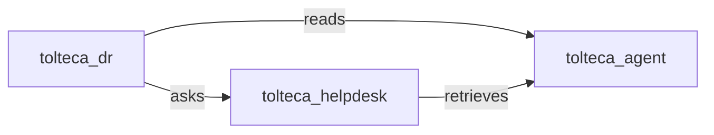
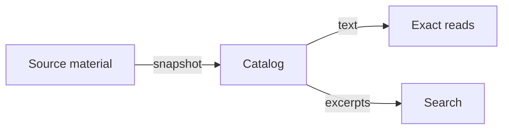
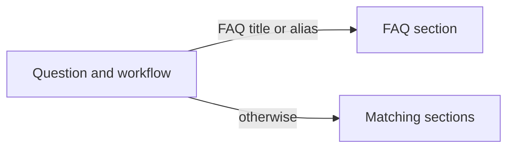
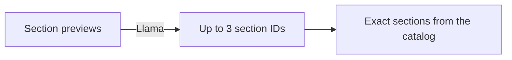
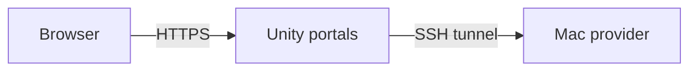

<!-- _class: cover -->
<!-- _paginate: false -->

# TolTEC helpdesk architecture

<p class="subtitle">Workflow portals, a reading assistant for people and authoritative material for software agents</p>

---

# Contents

<div class="cols">
<div>

[Science and operations workflows](#3)

[Package responsibilities](#4)

[Documentation ownership](#5)

[Sources and excerpts](#6)

[Documentation ingestion](#7)

[Audience-scoped retrieval](#8)

</div>
<div>

[Reading suggestions](#9)

[Conversation lifecycle](#10)

[Agent interfaces](#11)

[Unity and Mac deployment](#12)

[Test and production rendering](#13)

[Current capability limits](#14)

</div>
</div>

---

# Science and operations workflows

| Portal     | User task                  | Main handoff                                      |
| ---------- | -------------------------- | ------------------------------------------------- |
| Science    | Plan an observation        | Observation planner and proposal guidance         |
| Science    | Analyze released products  | Release documentation and package analysis guides |
| Science    | Reduce observations        | Deployment location and reduction software        |
| Operations | Support an observing shift | Unity product portal and diagnostic viewers       |
| Operations | Curate project products    | Manual reduction workflow and QA handoff          |
| Operations | Review data quality        | Unity CLI tools and team review procedures        |

<p class="note">The TolTEC observer supports the LMT shift remotely. QA acceptance and release sign-off remain team responsibilities; a dedicated QA dashboard is planned.</p>

<!-- Sources: src/tolteca_agent/material.py; data/use_cases/*.md. Curator guidance is present, but further TolProj integration is deferred. -->

---

# Package responsibilities

<div class="diagram">



</div>

- `tolteca_dr` presents science and operations workflows.
- `tolteca_helpdesk` selects existing guide sections with a Meta Llama provider.
- `tolteca_agent` serves authored sources to the portal and external agents.

<p class="note">One distribution owns three sibling modules under <code>src/</code>. External software agents read sources directly and own their reasoning and actions.</p>

<!-- Source: pyproject.toml; design/spec.md, Human helpdesk and Landing page. Arrows show calls by the portal and answer service into the source catalog. -->

---

# Documentation ownership

| Material                                     | Owner                             | Purpose                                 |
| -------------------------------------------- | --------------------------------- | --------------------------------------- |
| API, CLI and configuration guides            | Each software package             | Correct use of that software            |
| Task guidance and FAQs                       | `tolteca_agent` package data      | Complete end-user tasks across packages |
| Data handbook and glossary                   | `tolteca_tutorials/handbook/`     | Scientific interpretation, shared terms |
| Workflows, workshops, presentations, decks   | `tolteca_tutorials`               | Learning and developer explanations     |
| Example input data                           | `tolteca_ref_data`                | Data paired with runnable examples      |
| Design specifications                        | Owning repository's `design/`     | Developer contracts and rationale       |

<p class="note">The helpdesk links package-owned instructions; it does not replace them. <code>tolteca_dr</code> publishes the package guides, the handbook and the decks under each portal's <code>docs/</code>.</p>

<!-- Sources: design/spec.md, Purpose and content ownership, TolTEC Data Handbook, Architecture decks and presentations; data/learning.md. The handbook moved to tolteca_tutorials on 2026-11-08 and the decks on 2026-11-07. Decks, the handbook and design records are excluded from reading selection. -->

---

# Sources and excerpts

<div class="cols">
<div>

## Source

```text
source_id, package, path
text
version, version_match
revision, modified
case_ids
```

`as_dict()` adds the title and SHA-256 of the exact UTF-8 text.

</div>
<div>

## Passage

```text
source
heading
line_start, line_end
text
```

Inclusive, one-based source lines. The excerpt retains original text and line
endings.

</div>
</div>

<p class="note">A Git revision and content hash identify the material. They do not establish scientific applicability to a data release.</p>

<!-- Sources: tolteca_agent.sources.Source; tolteca_agent.catalog.Passage. SHA-256 is derived serialization metadata, not a separate stored Source field. -->

---

# Documentation ingestion

<div class="diagram">



</div>

- `agent.repositories` identifies the local documentation checkouts.
- The manifest selects package guides and their applicable workflows.
- Human context accepts bundled material and matching editable installations.
- Restart the service after changing its guides or package environment.

<!-- Sources: catalog.py _package_sources, _installed, _passages, Catalog. Search uses weighted lexical terms; no embedding model or vector database is required. Unverified sources can remain available to exact-reading agents with provenance. -->

---

# Audience-scoped retrieval

| Consumer                       | Retrieval scope                                 | Starting guidance                |
| ------------------------------ | ----------------------------------------------- | -------------------------------- |
| Science helpdesk               | Science-related guides across science workflows | Selected task and science FAQ    |
| Operations helpdesk            | Science and operations guides                   | Selected task and operations FAQ |
| Agent search with `case_id`    | Exact workflow assignment                       | Agent chooses what to read       |
| Agent search without `case_id` | All configured material                         | Agent chooses what to read       |

One documentation snapshot supports these different selection policies.
Operations inherits science material without requiring a second index.

<p class="note">Answer-context filtering is not an access-control boundary. Personnel authentication and restricted document hosting belong to deployment configuration.</p>

<!-- Sources: Catalog.search and Catalog.context; tests/test_catalog.py. Both portal HTTP material APIs expose the catalog. Science's human context excludes operation-only guides, but the API does not implement personnel authorization. -->

---

# Reading suggestions

<div class="diagram small">



</div>

<div class="diagram small">



</div>

The model returns only section IDs. Titles, text and links come from the catalog.

<p class="note">No generated answer and no review pass. Invalid or truncated provider output fails visibly. Results are labelled as suggestions; they do not claim to answer the question completely.</p>

<!-- Sources: tolteca_helpdesk.answers.ask and _request; _faq.match_faq; reading.ReadingList; design/spec.md, Human helpdesk; user decision 2026-10-20 (reading-only, Meta Llama only). Previews are at most 1,200 characters; exact FAQ matching is disabled for follow-ups; the selection schema enumerates the candidate IDs. -->

---

# Conversation lifecycle

<div class="cols">
<div>

## Browser session

- "Find guides with AI" opens the TolTEC Reading Assistant.
- Science and operations retain separate histories.
- Reloading or switching portals preserves the tab's conversation.
- Clear removes the saved conversation and draft question.

</div>
<div>

## Request context

```python
from tolteca_helpdesk.answers import Question

question = Question(
    text="How do I prepare an observation?",
    case_id="plan_observation",
)
```

Recent questions from the same workflow may inform a follow-up.

</div>
</div>

<p class="note">History stays in browser session storage. The provider receives the question, recent questions and section previews, never stored reading text. Reading cards are checked against the catalog before display.</p>

<!-- Sources: tolteca_dr.chat; tolteca_helpdesk.reading Question and Turn. Question.history accepts six turns; ask uses at most two from the same workflow. Provider logging policy remains provider-owned. -->

---

# Agent interfaces

| Interface              | Read contract                                    |
| ---------------------- | ------------------------------------------------ |
| Installed Python / CLI | Bundled guidance and configured package sources  |
| HTTP                   | Raw Markdown, JSON provenance and excerpt search |
| MCP over stdio         | `list_sources`, `search_sources`, `read_source`  |
| `llms.txt`             | Discovery index with links to authored material  |

```bash
tolteca_agent bootstrap
tolteca_agent cases --audience science
tolteca_agent read reduce_own_data
```

<p class="note">MCP resources use <code>tolteca://docs/{source_id}</code>. HTTP endpoints live under each portal prefix, including <code>/dr/science/api/material</code>.</p>

<!-- Sources: tolteca_agent.cli, http.py, mcp.py. The source ID is whitelisted. Exact source reads preserve text and provenance; agent-side reasoning is independent of the human AI service. -->

---

# Unity and Mac deployment

<div class="diagram small">



</div>

| Entry point       | Listener or process                           |
| ----------------- | --------------------------------------------- |
| `/dr/science/`    | Apache → science service on Unity `:8056`     |
| `/dr/operations/` | Apache → operations service on Unity `:8057`  |
| Provider API      | Unity loopback `:11435` → Mac Ollama `:11434` |

<p class="note">The Mac initiates the SSH connection to Unity. Arrows show application request flow. Each portal can restart independently; inference runs only on the Mac provider.</p>

<!-- Sources: deploy/*.service and apache-dr.conf; helpdesk-validation-20261019.md. The observation planner remains its existing independent service at /toltec_obs_planner_v3/. The Mac must remain awake, logged in and online. -->

---

# Test and production rendering

<div class="cols">
<div>

```yaml
dr:
  test_mode: true
  url_base_pathname: /dr/
  audience: science
helpdesk:
  provider_name: MacBook Pro
  ollama_url: http://127.0.0.1:11435
```

</div>
<div>

| Mode       | Visible information                                   |
| ---------- | ----------------------------------------------------- |
| Test       | Test-site notice, provider name, API origin and model |
| Production | User-facing workflow guidance and reading assistant   |

`test_mode: false` hides diagnostics. It does not alter model behavior or
certify answer quality.

</div>
</div>

<p class="note">The default provider URL is null: guidance remains available and chat explains that it is unavailable. Test mode does not enable the debugger.</p>

<!-- Sources: DrConfig.test_mode; HelpdeskConfig.provider_name; web.py _test_notice. Diagnostic URLs omit credentials, paths, query strings and fragments. -->

---

# Current capability limits

| Area                  | Current boundary                                                                         |
| --------------------- | ---------------------------------------------------------------------------------------- |
| Reading relevance     | Some questions miss the key section or select unrelated ones, including out-of-scope ones. |
| Planner knowledge     | The planner is linked; detailed planner instructions remain sparse in the source corpus. |
| Science recipes       | Complete tutorials and release-specific guidance remain pending.                         |
| Operations            | QA criteria and dashboard remain unfinished; shared account access is not yet deployed.   |
| Provider availability | The Mac and SSH connection must remain available.                                        |

<p class="note">The public site is labelled for testing. Authored source access is usable independently of the reading assistant.</p>

<p class="meta"><a href="#2">Contents</a> &nbsp; / &nbsp; <a href="#4">Components</a> &nbsp; / &nbsp; <a href="#9">Reading suggestions</a> &nbsp; / &nbsp; <a href="#12">Deployment</a></p>

<!-- Sources: helpdesk-reading-20261020.md (35 questions; observed ranking failures: PSD settings table omitted for earlier questions, input listing selects array slicing, scan speed selects obsnum syntax, out-of-scope questions return configuration sections); design/spec.md, Shared account access (specified; implementation uncommitted on 2026-11-08). No production-accuracy or unattended-operations claim is made. -->
