<!-- _class: cover -->

Status · October 2026

# TolTECA v3

From acquisition to usable products

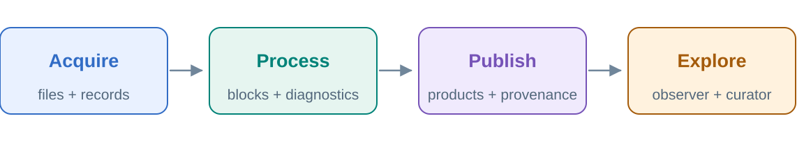

Data · workflows · operations · user support

<!--
0:30. Working components and exercised workflows, with remaining science and deployment work. The full v2 science pipeline has not yet migrated.
-->

---

<!-- _header: Data lifecycle -->

# From observation to the next reduction

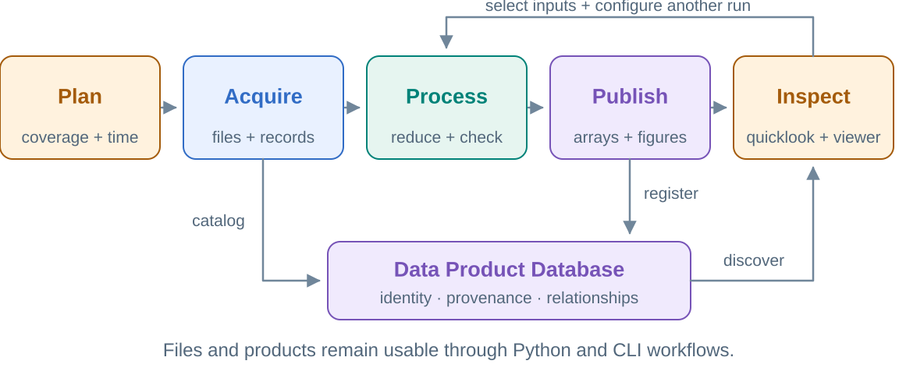

<!--
1:30. The observation planner supports preparation before acquisition. Raw files and acquisition records enter through discovery. The product database records identities, relationships and locations. Artifacts are actual arrays and figures. Inspection can lead to another run. The helpdesk connects this broader user journey.
-->

---

<!-- _header: Run modes -->

# One workflow, several ways to run it

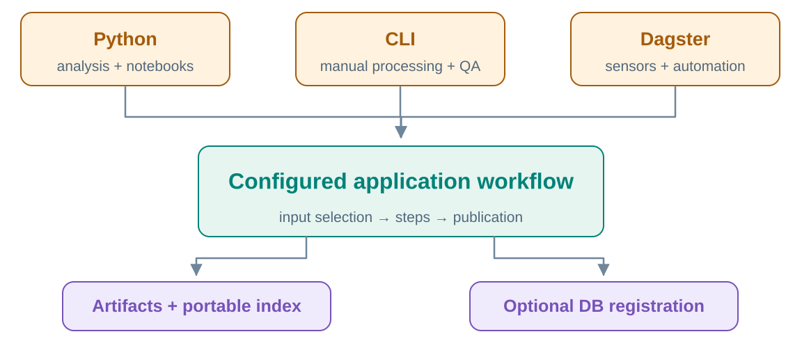

<!--
1:00. Python supports exploration and reusable computations. CLI supports manual processing and QA. Dagster supplies scheduling and run supervision. Configuration and scientific workflow stay in the application packages. Writing a product does not require a database; registration is a configurable output action.
-->

---

<!-- _header: Data structure -->

# Observation → acquisition → interface → block

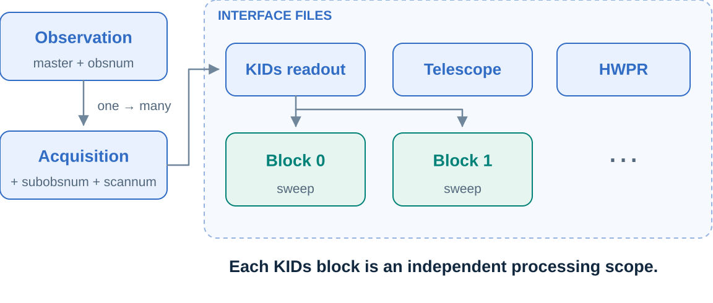

<!--
1:15. An observation number may contain multiple acquisitions, identified by subobservation and scan. Each acquisition has interface files. KIDs files can hold multiple blocks. File-level readers provide metadata and explicit block identification; the KIDs runner iterates the blocks. Telescope and HWPR readers exist, while the processed-product integration currently exercises KIDs.
-->

---

<!-- _header: Scientific processing -->

# A block owns its data and analyses

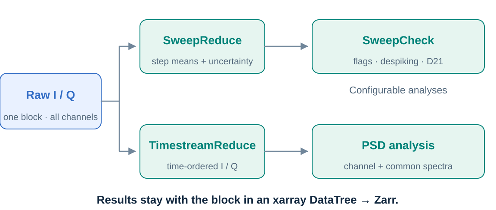

<!--
1:30. SweepReduce averages repeated samples at each sweep step, retaining I/Q uncertainties. SweepCheck ports the v2 core checks, despiking and D21 diagnostics. Timestream processing provides time-domain data and configurable PSD analysis. These are selectable operations, not a requirement to run every analysis. The runner owns acquisitions and interfaces; steps operate on a block. Detector finding and full model solving are not part of this demonstrated slice.
-->

---

<!-- _header: Saved data → interactive inspection -->

# Open a product. Select a block and channel.

2 tune blocks

632 channels per block

Selection reads the saved Zarr.

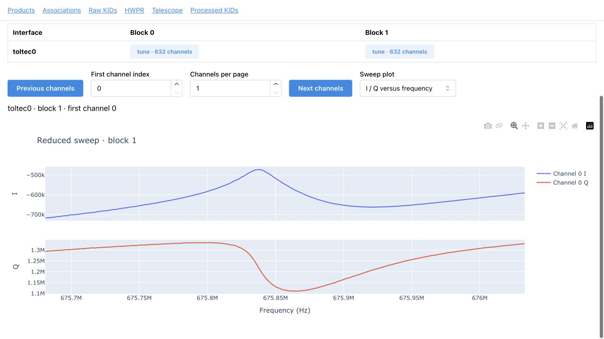

Reference acquisition 145609 · toltec0 · block 1

<!--
1:00. This is the working viewer reading the published Docker reference result. The user selects a product location, interface, block and channel. The viewer does not run SweepCheck again. Saved diagnostic views and exported figures share the same configurable visualization machinery.
-->

---

<!-- _header: Live observing workflow -->

# Telescope acquisition → observer feedback

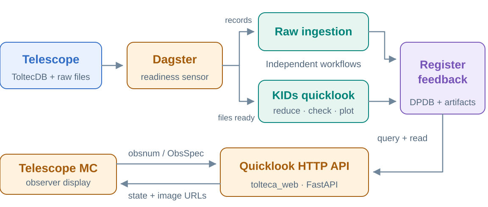

Processing runs while the telescope continues its next exposure.

<!--
1:15. The external acquisition system writes raw files and ToltecDB records. Dagster observes record discovery and file readiness; Valid and local-file availability gate live KIDs processing. Raw ingestion and quicklook computation are independent workflows. Product registration joins the available raw records and published feedback, making the result queryable in DPDB. MC asks the separate HTTP service for feedback and displays the returned images to the observer. Inspection informs the observing team's decisions; the API does not control the telescope. These application workflows also run through CLI without Dagster. Unity inventory, transfer and reprocessing operate independently of this site quicklook path.
-->

---

<!-- _header: Observatory integration · MC HTTP interface -->

# Quicklook API: state and prepared plot URLs

MC request · one observation number<code>GET /api/ql?obs_spec=145609</code>

<h2>JSON response</h2>
Acquisition / run identity <code>kids_summary</code> · <code>pointing</code>

<h2>Explicit readiness</h2>
<code>ready</code> · <code>pending</code> <code>unavailable</code> · <code>unknown</code>

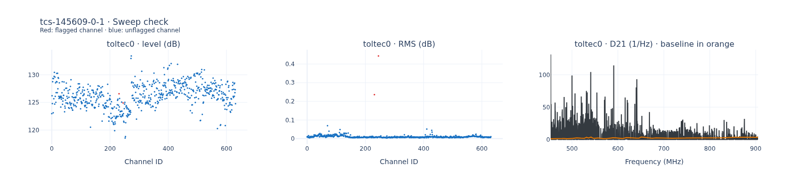

MC fetches the returned URL · requests never launch or wait for reduction

<!--
1:00. The public contract is GET /api/ql?obs_spec=145609, with named KIDs summary and pointing collections carrying result identity, status and plot URLs. The same endpoint accepts GET /api/ql?obs_spec=tcs-145609-0-1 and broader ObsSpec selections. One obsnum may cover several scans; each is identified in the response. MC currently sends one obsnum at a time, including consecutive requests for grouped observing sequences. Follow the plot URL in the relevant sweep block or pointing array to fetch the image. Ready feedback uses DPDB and a cached immutable descriptor without contacting Dagster. Missing feedback can use a bounded optional Dagster status lookup; its default 100 ms deadline is not a total response-time guarantee. The FastAPI service is separate from the Dash portal. KIDs blocks contain sweep checks and detector-finding summaries; pointing arrays contain fitted offsets and optional figures. Host and port are deployment settings, not part of the endpoint contract.
-->

---

<!-- _header: Product provenance -->

# Preserve the run. Choose what to present.

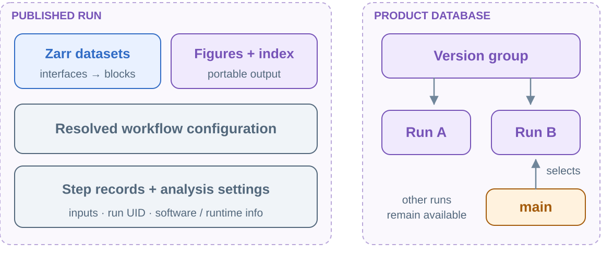

<!--
1:30. A run has a stable UUID and a readable name. The effective configuration is saved after resolving defaults and overrides. Step records and analysis configuration snapshots remain with the data. A version group links realizations, and a tag such as main selects a run. Changing the tag does not rewrite the old arrays. Replay also needs the same inputs and software environment; saved configuration is necessary, not a promise of bitwise reproducibility. Diagram groups stored information conceptually: index and Zarr carry different parts.
-->

---

<!-- _header: Calibration and lineage -->

# Calibration follows the interfaces

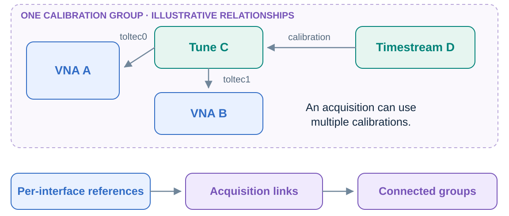

<!--
1:15. Arrows in the upper graph point from an acquisition to its calibration. Readout interfaces need not be synchronized to the same VNA. Persistent per-interface facts preserve that information; acquisition associations and calibration groups are derived from them. Live updates touch affected records rather than rebuild all history. Unknown references remain visible instead of inventing a master. This diagram is illustrative, not a claim about the screenshot acquisition.
-->

---

<!-- _header: Site and archive -->

# Independent inventories, one combined view

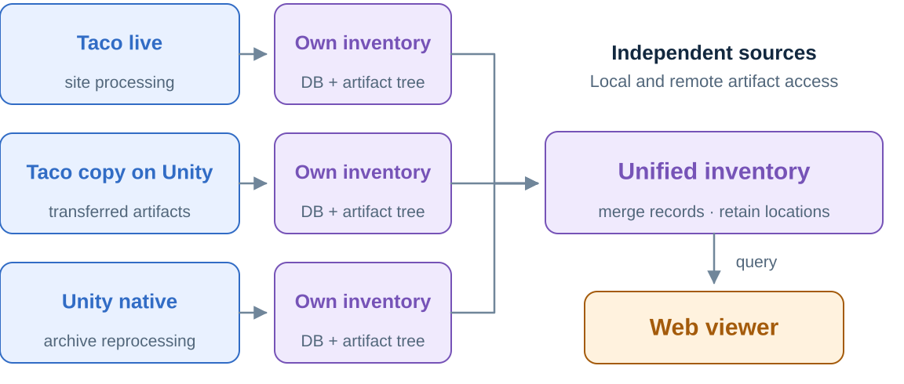

<!--
1:30. Taco records live operations. A transferred artifact tree has its own inventory and can remain unchanged while Taco advances. Unity reductions create their own results. The unified inventory combines compatible records and locations without taking over the source databases. Incremental transport follows committed database updates, including CLI work. Namespace records processing context; locations specify how to read an artifact. Remote and local availability are not inferred from a namespace string.
-->

---

<!-- _header: Deployment and execution -->

# Services supervise. Compute nodes reduce.

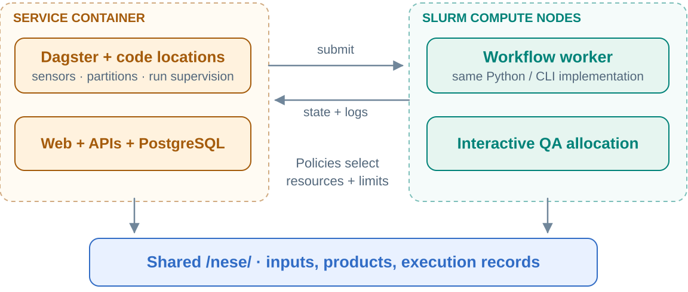

Unity execution design · exercised with service and compute containers in Docker

<!--
1:30. A deployment location supplies the software and configured service profiles. Code locations register workflows in Dagster. Submission policies select the permitted Slurm target, resources and concurrency limits. Slurm owns allocations; manual QA can use an interactive allocation and the same CLI. PostgreSQL serves database clients; shared storage holds inputs, products and execution records. Real Unity authentication, accounts, permissions and enforcement still require site validation.
-->

---

<!-- _header: Run supervision -->

# The reduction has a visible execution history

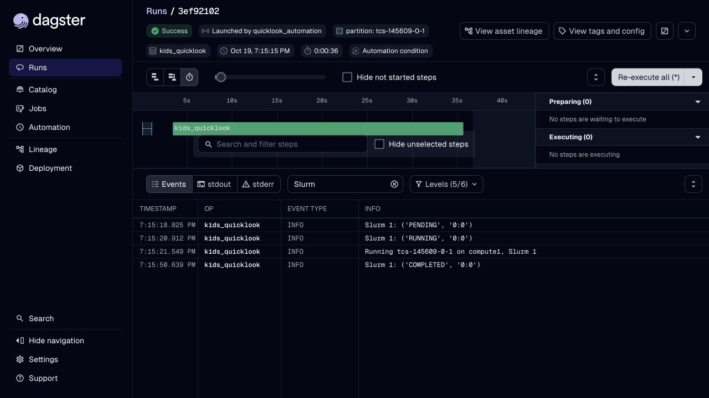

Submit & trackBounded retryCancelRecover a known attempt

<!--
1:00. This is a completed reference run, with Slurm transitions and the compute host in the event log. The adapter retains scheduler and product identities. Retry is explicit and bounded. A known allocation can be reattached after supervisor failure; ambiguous submission is not blindly retried. Separate registration can be retried using the published output without recomputing the scientific result.
-->

---

<!-- _header: User support · work in progress -->

# tolteca_helpdesk: guidance and AI assistance

<h2>Task guidance</h2>
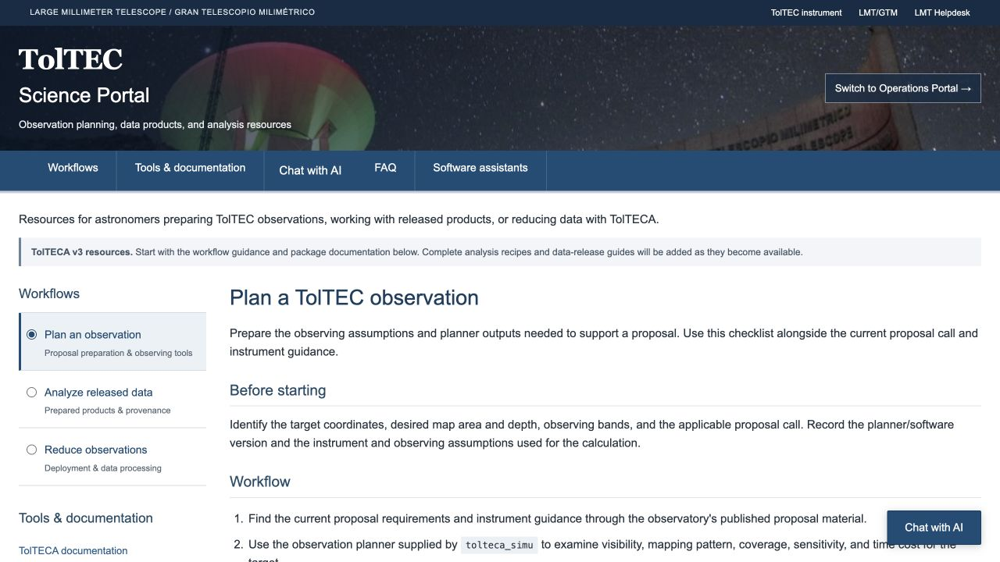

<strong>Science</strong> Plan · analyze · reduce

<strong>Operations</strong> Observe · curate · QA

<h2>AI answer excerpt</h2>

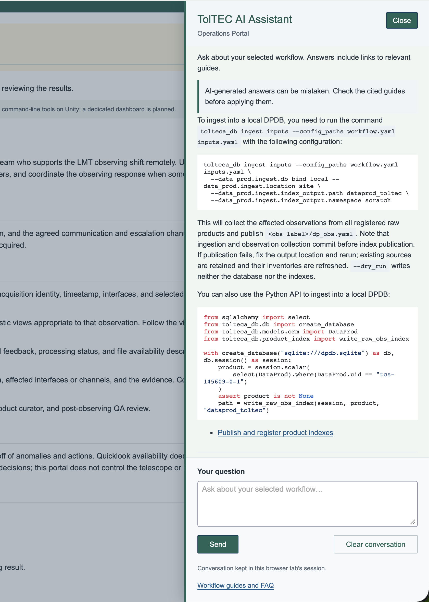

Linked source guide

<strong>Work-in-progress example — answer accuracy needs improvement.</strong>

<!--
1:30. The companion tolteca_dr portal organizes guidance around tasks and links to the planner, software guides and tutorials. Science and operations have separate navigation and retrieval scopes. The operations observer supports a live shift; proposal planning belongs to science. The answer and citation are two crops from the user's Operations Portal screenshot, taken on 2026-10-19. This is a work-in-progress example, not a verified recipe. The complete answer incorrectly describes index publication in its Python example as ingestion. Source links help review an answer; they do not establish correctness. Answer accuracy needs improvement. The portals provide guidance, not instrument control, live monitoring or QA approval.
-->

---

<!-- _header: Helpdesk and software assistants · work in progress -->

# Shared sources, distinct ways to get help

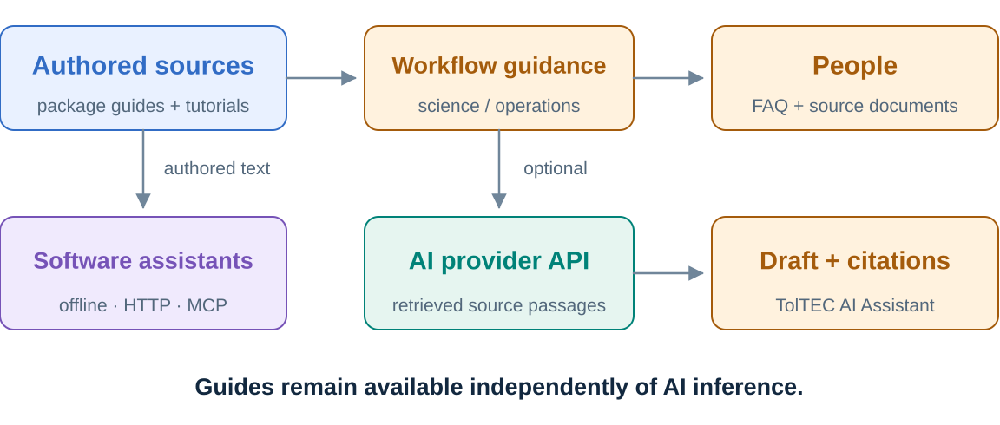

AI answers are reviewable drafts; answer accuracy remains under validation.

<!--
1:00. tolteca_helpdesk grounds human answers in selected authored sources and attaches citations. The AI provider is a separate service, including for local development. The portal host does not run inference. Answer accuracy remains under validation. tolteca_agent exposes the authored documents directly through offline, HTTP and MCP access, without using the human model. Generated answers do not become reference material. Tutorial recipes remain in tolteca_tutorials; package guides remain owned by their packages.
-->

---

<!-- _header: Current scope -->

# Working foundations; science and site rollout ahead

<h2>Working now</h2>

Read → reduce → inspectBlock data, sweep checks, PSD, Zarr views

Publish → trace → combineRuns, tags, calibration links, inventories

Schedule → superviseCLI and Dagster; Slurm integration in Docker

Find guidanceScience and operations portals; authored sources

<h2>Still in progress</h2>

Broader science workflowsDetector finding, solving and further interface integration

Unity operational rolloutSite policy, authentication, resource and load validation

Helpdesk and learning workflowsAnswer accuracy and complete recipes

Formal QA and release workflowReview process and dashboard

<a href="#2">Lifecycle</a> · <a href="#5">Processing</a> · <a href="#7">Observing</a> · <a href="#9">Products</a> · <a href="#11">Taco–Unity</a> · <a href="#12">Execution</a> · <a href="#14">Helpdesk</a>

<!--
1:15. Distinguish the exercised processing and infrastructure slice from the complete science pipeline and observatory rollout. The current systems provide a common basis for the next science operations, human review and end-user guidance. Processing success does not mean QA acceptance or a science release. The detailed architecture decks provide API-level material for questions.
-->
